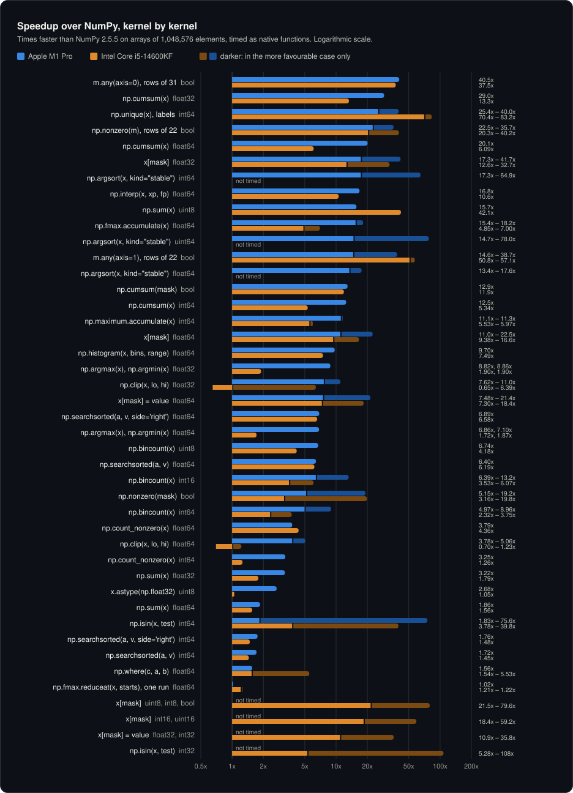

# hotkernels

Fast kernels for the NumPy operations where NumPy is slow, delivered as a zero-friction drop-in: hand-written assembly where it can actually win, plain C where the compiler is already enough.

```python
import hotkernels
hotkernels.install()
```

Kernels are written by coding agents iterating against a judge. The judge checks every kernel against NumPy and times it against NumPy and naive `clang -O3` C.

**On an Apple M1 Pro, the 23 kernels measured there are all faster than NumPy at every size measured. At a million elements, 17 of the 22 in the table below are more than 5x faster and the best is 76x. Twenty-one return NumPy's result bit for bit.**

The kernels exist for two architectures, written separately against the same specs: ARM64 NEON for Apple Silicon, and x86-64 AVX2 for Linux on processors of the x86-64-v3 level. The tables below are the ARM64 kernels on an Apple M1 Pro. The x86-64 kernels' figures on an Intel Core i5-14600KF are in [docs/kernel-findings.md](docs/kernel-findings.md#x86-64) from the judge, with the reports in [`results/`](results), and in [delivery/results/intel-r-core-tm-i5-14600kf.md](delivery/results/intel-r-core-tm-i5-14600kf.md) from Python; NumPy is a different opponent there, with vector loops of its own for several of these calls, so the two sets of figures are not expected to agree. The plan the x86-64 kernels were written to is [docs/x86-64-design.md](docs/x86-64-design.md).

Kernels from a second shortlist ([docs/second-shortlist-design.md](docs/second-shortlist-design.md)) are written for x86-64 first. Until their ARM64 assembly exists they ship as their C on ARM64, and they are not in the tables below; their x86-64 figures are in [docs/kernel-findings.md](docs/kernel-findings.md#second-shortlist). So far: `cumsum_bool`, for `np.cumsum` on a boolean array, `where_f64`, for `np.where(mask, a, b)` on float64 and int64, `cummax_i64`, for `np.maximum.accumulate` and `np.fmax.accumulate` on int64, `cumfmax_f64`, for `np.fmax.accumulate` on float64, `fmax_reduce_f64`, for `np.fmax.reduceat` on float64, `any_rows_bool`, for `m.any(axis=1)` on a two-dimensional boolean array, `bincount_i16` and `bincount_i64`, for `np.bincount` on int16 and int64, and `hypot_f64`, for `np.hypot` on float64, where the C library computes `hypot` as the kernel does, which `install()` checks on the machine it runs on: as recent glibc does on x86-64, and as macOS's own `hypot` does on ARM64, where `hypot_f64` has assembly as well (4.5x faster than the C library's `hypot` on an Apple M1 Pro; [docs/kernel-findings.md](docs/kernel-findings.md#hypotenuse-nphypot-on-float64)). Calls on short arrays whose cost is NumPy's own call path are served by plain C loops inside the binding instead of kernels: `np.clip` on int64 arrays of up to 4,096 elements, `np.round` on float64 arrays of up to 4,096 elements, and `np.median` on float64 arrays of up to 128 elements.

## Results

How many times faster each kernel is than NumPy, and than the same loop written in plain C and compiled with `clang -O3`:



| NumPy call | Elements | vs NumPy | vs `clang -O3` |
|---|---|---|---|
| `np.cumsum(x)` | float32 | 29.0x | 7.83x |
| `np.cumsum(x)` | float64 | 20.1x | 5.48x |
| `x[mask]` | float32 | 17.3x – 41.7x | 2.70x – 5.70x |
| `np.interp(x, xp, fp)` | float64 | 16.8x | 6.40x |
| `np.sum(x)` | uint8 | 15.7x | 5.07x |
| `np.cumsum(x)` | int64 | 12.5x | 1.95x |
| `x[mask]` | float64 | 11.0x – 22.5x | 1.67x – 4.10x |
| `np.histogram(x, bins, range)` | float64 | 9.70x | 3.59x |
| `np.argmax(x)`, `np.argmin(x)` | float32 | 8.82x, 8.86x | 26.6x, 26.7x |
| `np.clip(x, lo, hi)` | float32 | 7.62x – 11.0x | 1.00x – 1.44x |
| `x[mask] = value` | float64 | 7.48x – 21.4x | 4.64x – 19.0x |
| `np.argmax(x)`, `np.argmin(x)` | float64 | 6.86x, 7.10x | 12.7x, 13.2x |
| `np.bincount(x)` | uint8 | 6.74x | 1.31x |
| `np.searchsorted(a, v)` | float64 | 6.40x | 8.83x |
| `np.nonzero(mask)` | bool | 5.15x – 19.2x | 2.47x – 8.08x |
| `np.count_nonzero(x)` | float64 | 3.79x | 1.28x |
| `np.clip(x, lo, hi)` | float64 | 3.78x – 5.06x | 1.01x – 1.35x |
| `np.count_nonzero(x)` | int64 | 3.25x | 1.03x |
| `x.astype(np.float32)` | uint8 | 2.68x | ships as the C |
| `np.isin(x, test)` | int64 | 1.83x – 75.6x | 1.00x – 5.34x |

Apple M1 Pro, NumPy 2.5.5, Apple clang 21, arrays of 1,048,576 elements, where the fixed cost of a call no longer matters. A range covers the two cases the kernel is timed in: 5% and 50% of the elements selected for the mask kernels, test values close together or far apart for `isin`, and, for `clip`, bounds of (-0.5, 0.5) at the high end and bounds of (0, 1) on data that holds negative zeros at the low end. The `np.searchsorted`, `np.interp` and `np.clip` rows are each the mean of ten runs on a machine that was not fully quiet (load average about 3 for most runs, higher for some); the other rows are single runs. Results at every size from 16 to 16,777,216 elements, with confidence intervals, are in [docs/kernel-findings.md](docs/kernel-findings.md).

The same kernels on an Apple M4 Max, against the M1 Pro figures above:

| NumPy call | Elements | M1 Pro, vs NumPy | M4 Max, vs NumPy | M4 Max, vs `clang -O3` |
|---|---|---|---|---|
| `np.cumsum(x)` | float32 | 29.0x | 20.1x | 5.27x |
| `np.cumsum(x)` | float64 | 20.1x | 17.4x | 3.99x |
| `x[mask]` | float32 | 17.3x – 41.7x | 15.6x – 40.4x | 3.30x – 6.10x |
| `np.interp(x, xp, fp)` | float64 | 16.8x | 16.5x | 5.19x |
| `np.sum(x)` | uint8 | 15.7x | 14.0x | 4.87x |
| `np.cumsum(x)` | int64 | 12.5x | 11.2x | 1.91x |
| `x[mask]` | float64 | 11.0x – 22.5x | 11.4x – 24.3x | 2.00x – 4.49x |
| `np.histogram(x, bins, range)` | float64 | 9.70x | 8.55x | 3.12x |
| `np.argmax(x)`, `np.argmin(x)` | float32 | 8.82x, 8.86x | 9.57x, 9.17x | 27.7x, 26.6x |
| `np.clip(x, lo, hi)` | float32 | 7.62x – 11.0x | 3.83x – 5.38x | 1.00x – 1.39x |
| `x[mask] = value` | float64 | 7.48x – 21.4x | 11.1x – 23.6x | 5.18x – 20.7x |
| `np.argmax(x)`, `np.argmin(x)` | float64 | 6.86x, 7.10x | 7.76x, 7.46x | 13.7x, 13.2x |
| `np.bincount(x)` | uint8 | 6.74x | 6.78x | 1.26x |
| `np.searchsorted(a, v)` | float64 | 6.40x | 1.48x | 7.60x |
| `np.nonzero(mask)` | bool | 5.15x – 19.2x | 3.71x – 21.6x | 2.93x – 9.80x |
| `np.count_nonzero(x)` | float64 | 3.79x | 3.44x | 1.29x |
| `np.clip(x, lo, hi)` | float64 | 3.78x – 5.06x | 1.92x – 2.69x | 1.00x – 1.39x |
| `np.count_nonzero(x)` | int64 | 3.25x | 3.36x | 1.02x |
| `x.astype(np.float32)` | uint8 | 2.68x | 4.41x | ships as the C |
| `np.isin(x, test)` | int64 | 1.83x – 75.6x | 1.57x – 68.2x | 1.00x – 5.61x |

Apple M4 Max, NumPy 2.5.5, Apple clang 21, the same sizes and cases. One locked `uv run judge run <kernel> --record` per kernel, one after another, at a load average of 1.3 to 1.9. The reports are in [`results/`](results). Against NumPy most figures are within 15% of the M1 Pro's. Lower: `np.clip` by about half on both types, `np.searchsorted` with 1,000 needles from 6.40x to 1.48x, float32 `np.cumsum` from 29.0x to 20.1x, and `np.nonzero` with half selected from 5.15x to 3.71x. Higher: `x.astype(np.float32)` from 2.68x to 4.41x, and `x[mask] = value` with few selected from 7.48x to 11.1x. For `np.clip` and `np.searchsorted` the lead over the C is about the same on both machines, so NumPy is what got faster there; why has not been established.

What stands behind the numbers:

- **Checked against NumPy, not against a description of it.** Every kernel is compared with NumPy's own output on inputs that include NaN, infinities, signed zeros, ties and denormals. Thirty of the 32 match bit for bit. The two float `cumsum` kernels regroup the additions, which is where their speed comes from, and stay within a declared error bound. One, `hypot_f64`, matches only where the C library's `hypot` is the algorithm it computes, recent glibc's on x86-64 and macOS's own on ARM64; `install()` compares the two on the machine it runs on and leaves `np.hypot` to NumPy where they differ.
- **Memory-safe by test.** Each kernel runs with its buffers placed against inaccessible pages, so reading or writing one byte outside them crashes the check.
- **Assembly only where it wins.** A kernel keeps its assembly only if the judge finds it significantly faster than the compiled C. `astype` from `uint8` to `float32` did not pass that bar and ships as C.

What the numbers do not say:

- **The table times the kernels as native functions.** From Python a call also pays for NumPy's call path and, for `x[mask]` and `np.nonzero`, for allocating the result. Those figures are under [From Python](#from-python).
- **`np.searchsorted` and `np.interp` are shown with 1,000 needles against 1,048,576 sorted elements.** With 64 needles they are 2.3x and 15.7x faster than NumPy there, and a call that short is partly NumPy's fixed cost. [docs/kernel-findings.md](docs/kernel-findings.md#searchsorted-and-interp) has both.
- **`np.searchsorted(a, v, side='right')` is not in the table or the chart.** Its kernel is the left side's with one comparison turned round. With 1,000 needles it is 4.2x to 21x faster than NumPy across array lengths, and 6.9x against 1,048,576 sorted elements, as the mean of the same ten runs. [docs/kernel-findings.md](docs/kernel-findings.md#searchsorted-and-interp) has the table.
- **Float `np.cumsum` is installed only on request.** It is not bit-identical to NumPy and its output is not monotonic for non-negative input, so it needs `hotkernels.install(inexact=True)`.
- **Two results depend on the arguments.** `np.isin` is fast when the test values all lie between 0 and 65,534 or within 32,767 of the first one, and ties the C otherwise. `np.clip` with a lower bound of zero, as in `np.clip(x, 0, 1)`, is about 1.3x over the C in cache when the data holds no negative zeros and runs at the speed of the C when one occurs in the first few thousand elements; with an upper bound of `-0.0` it always runs at the speed of the C. Those cases are timed, and are the low ends of those rows.
- **Scalar arguments are verified for the values each spec lists.** `np.clip` is checked with twelve pairs of bounds and `np.histogram` with sixteen bin counts and ranges, not with every possible one.
- **One machine.** Every figure is from a single Apple M1 Pro.

## From Python

The same machine, timing one Python statement from call to result, on plain NumPy and after `hotkernels.install()`:

| Statement | Elements | 16 elements | 1,048,576 elements |
|---|---|---|---|
| `np.argmax(x)` | float32 | 14.2x | 8.89x |
| `x.argmax()` | float32 | 3.11x | 8.87x |
| `np.clip(x, -0.5, 0.5)` | float32 | 11.0x | 9.92x |
| `np.clip(x, -0.5, 0.5)` | float64 | 9.76x | 4.93x |
| `x[mask]`, half selected | float32 | 2.49x | 31.0x |
| `x[mask]`, half selected | float64 | 2.54x | 15.9x |
| `x[mask] = 0.0`, half selected | float64 | 5.24x | 20.3x |
| `np.nonzero(mask)`, few selected | bool | 1.25x | 13.5x |
| `np.cumsum(x)` | int64 | 1.95x | 12.7x |
| `x.astype(np.float32)` | uint8 | 1.89x | 4.11x |
| `np.sum(x)` | uint8 | 32.5x | 15.7x |
| `np.count_nonzero(x)` | float64 | 3.59x | 3.74x |
| `np.histogram(x, 50, (-3.0, 3.0))` | float64 | 6.16x | 9.43x |
| `np.bincount(x)` | uint8 | 2.32x | 6.66x |
| `np.isin(x, eight_values)` | int64 | 71.2x | 18.8x |
| `np.searchsorted(a, v)` | float64 | 1.51x | 8.57x |
| `np.searchsorted(a, v, side='right')` | float64 | 1.46x | 9.16x |
| `np.digitize(x, bins)`, 1,000 bin edges | float64 | 1.10x | 26.7x |
| `np.interp(x, xp, fp)` | float64 | 5.54x | 22.4x |

At 16 elements most of the gain is NumPy's own call path being skipped, not the kernel. `np.clip(x, -0.5, 0.5)` on 16 elements takes 1.2 µs on plain NumPy, nearly all of it NumPy's Python wrapper and ufunc machinery, and about 120 ns with hotkernels, which calls the kernel before any of that runs when the bounds are plain numbers and there is no `out`.

- **A call no kernel takes costs under a nanosecond more**, or a percent or so where a hook has to read its arguments. `x[3]` takes 60.5 ns on plain NumPy and 60.8 ns with hotkernels installed; `np.clip(x, -0.5, None)` takes 1.03 µs and 1.04 µs.
- **An unmodified program.** [examples/workload.py](examples/workload.py) uses eleven of these operations on two million elements. It runs in 45 ms on plain NumPy and 8.4 ms with the one line added, with the same results bit for bit.
- **`np.searchsorted` and `np.interp` are timed with as many needles as elements**, and `np.digitize` with 1,000 bin edges. With a sorted array of 1,000 elements and a million needles `np.searchsorted` is 27x faster on either side and `np.interp` 19x.
- **Checked from Python.** 96,734 NumPy calls give the same result, exceptions and warnings with hotkernels as without, and NumPy's own test suite gives the same outcome for each of its 47,234 tests.
- **Taken on a machine in use**, in one run that started at a load average of 2.0. The full table is in [delivery/results/apple-m1-pro.md](delivery/results/apple-m1-pro.md). The same run on an Apple M4 Max, also at a load average of 2.0, is in [delivery/results/apple-m4-max.md](delivery/results/apple-m4-max.md).

## What is here

- **The judge** (`judge/`): checks a kernel for correctness and memory safety, and reports how fast it is. It runs on macOS ARM64 and on Linux x86-64.
- **Fixture kernels** (`judge/fixtures/`): `argmax_f32`, `compress_f32`, `compress_scratch_f32`, `tally_u8` and `rank_u8`, used to test the judge itself, each with an ARM64 and an x86-64 version.
- **The survey** (`survey/`): measures NumPy against naive C per operation, to decide which kernels are worth writing. It runs on macOS ARM64 and on Linux x86-64. Recorded results for both are in `survey/results/`.
- **Kernels** (`kernels/`): 32 kernels for 22 NumPy operations, each with a spec, a naive C reference and, where assembly beats the C, an assembly version per architecture: 23 for ARM64 and 32 for x86-64. Each kernel's `attempts.md` lists every optimisation tried, kept or not.
- **The package** (`hotkernels/`): what a user installs. A C extension points NumPy at the kernels, and `install()`, `uninstall()`, `enabled()` and `report()` control it. `install()` installs the 30 kernels that return NumPy's result bit for bit, and `install(inexact=True)` the other two.
- **The delivery tool** (`delivery/`): tests and times the package from Python. Recorded timings are in `delivery/results/`.
- **An example** (`examples/workload.py`): a NumPy program written without hotkernels in mind, used to show the effect of the one line.
- **Release tooling** (`release/`, `release-notes/`): the notes each pull request leaves, and the commands that turn them into a release. Publishing to PyPI runs in [`.github/workflows/release.yml`](.github/workflows/release.yml).
- **The documentation site** (`docsite/`): the pages published at [sofeikov.github.io/hotkernels](https://sofeikov.github.io/hotkernels/), with a technical report on how all of this works. Its figures are read from the files above when it is built.

Supported platforms for the package, the judge and the survey: macOS on Apple Silicon (ARM64), and Linux on x86-64. On Linux the package needs a processor with the x86-64-v3 instruction sets (AVX2, FMA, BMI1, BMI2, LZCNT, MOVBE, POPCNT: Intel since 2013, AMD since 2015).

## Using hotkernels

```bash
pip install hotkernels
```

Wheels are published for macOS on Apple Silicon and for Linux on x86-64 (glibc), CPython 3.11 to 3.14. Elsewhere the package installs from its source distribution without a compiler, and `install()` does nothing. In this repository, `uv sync` builds the package from `kernels/`; that needs the Xcode command line tools on macOS, or a C compiler and GNU binutils on Linux.

```python
import numpy as np
import hotkernels

hotkernels.install()            # NumPy now uses the kernels, in the whole process

x = np.random.standard_normal(1_000_000)
x[x > 0]                        # served by a kernel
np.clip(x, 0, 1)                # served by a kernel
x[::2].sum()                    # not something a kernel handles: NumPy does it, as before

print(hotkernels.report())      # what is installed, and how often each kernel ran
hotkernels.uninstall()          # NumPy is exactly as it was
```

- `hotkernels.install(inexact=True)` also installs the kernels that are not bit-identical to NumPy.
- `with hotkernels.enabled():` installs for the duration of a block.
- A kernel takes a call only when the array is a plain contiguous `ndarray` of its element type and every other argument is one it implements. Any other call goes to NumPy as it was written.
- On any other platform, and on an x86-64 processor without the x86-64-v3 instruction sets, `install()` does nothing and `report()` says why.
- `python -m hotkernels script.py [args ...]` runs an unmodified script with hotkernels installed; `-m module` runs a module, and `--report` prints the report at the end.

## Using the judge

Requires [uv](https://docs.astral.sh/uv/) and a C toolchain: the Xcode command line tools on macOS, or clang and GNU binutils on Linux x86-64.

```bash
uv run judge selftest            # prove the judge catches known-bad kernels
uv run judge check argmax_f32    # lint and correctness for one kernel
uv run judge run argmax_f32      # correctness, then a timing report
```

## Using the survey

```bash
uv run survey run                 # measure every candidate; takes 3 to 15 minutes, by machine
uv run survey run --only argmax   # measure the candidates whose name matches
uv run survey report survey/results/apple-m1-pro.json   # regenerate a report
```

## Using the delivery tool

```bash
uv run delivery check         # every hooked call, with and without hotkernels; about a minute
uv run delivery demo          # run examples/workload.py both ways and compare
uv run delivery time          # time statements from Python; add --record to keep the result
uv run delivery numpy-tests   # NumPy's own test suite, both ways; about ten minutes
```

## Using the documentation site

```bash
uv run docsite serve   # build the site and serve it at http://127.0.0.1:8000, rebuilding on change
uv run docsite build   # build it into build/site
```

Pages are Markdown under `docsite/pages/` and are listed in `docsite/site.toml`.

## Using the self-hosted runners

The macOS jobs of a pull request run on the maintainer's own Mac when it is online, and on GitHub's runners otherwise. GitHub's macOS runners are often not assigned for a quarter of an hour, after which a job fails. A pull request from a fork and a tag always use GitHub's runners, so a published wheel never comes from that Mac.

To set the runners up on a Mac with Apple Silicon:

```bash
sudo sysadminctl -addUser ci-runner -fullName "CI Runner" -password -   # once: a standard account for the jobs
.github/runners/setup.sh 4        # install four runners, so four jobs run at once
.github/runners/setup.sh remove   # remove them again
```

- **They start by themselves** at boot and after a system update, as system services under the `ci-runner` account. With FileVault on, that is once someone has logged in at the Mac's login screen.
- **`RUNNER_STATUS_TOKEN`** is a repository secret the workflows use to see whether a runner is online: a fine-grained personal access token for this repository with read access to Administration. Store it with `gh secret set RUNNER_STATUS_TOKEN`. When it is missing or expired, every job goes to GitHub's runners.
- **Asleep, switched off or away**, the Mac is skipped and jobs go to GitHub's runners. GitHub forgets a runner that has not connected for about two weeks; run the setup again then.
- **The repository is public.** Under Settings, Actions, General, set "Fork pull request workflows" to require approval for all external contributors, so that nobody else's pull request can run on the Mac.

[`pick-runner.yml`](.github/workflows/pick-runner.yml) is the workflow that chooses.

## Making a release

Each pull request that changes the package leaves a note in `release-notes/upcoming/` (see [AGENTS.md](AGENTS.md#release-notes)). To release:

```bash
uv run release prepare 0.2.0   # set the version and compile the notes into release-notes/0.2.0.md
```

Write the highlights at the top of that file, re-measure on native hardware, and merge it as a pull request. Then, on an up-to-date `main`:

```bash
uv run release tag             # tag the merged commit v0.2.0 and push the tag
```

The tag starts the release workflow, which builds and tests the wheels and waits for the maintainer to approve the `pypi` deployment before uploading. [docs/release-design.md](docs/release-design.md) has the details.

## Documentation

- [sofeikov.github.io/hotkernels](https://sofeikov.github.io/hotkernels/): getting started, and the technical report with interactive figures
- [docs/core-design.md](docs/core-design.md): what the project is building and why
- [docs/judge-design.md](docs/judge-design.md): how kernels are checked and timed
- [docs/survey-design.md](docs/survey-design.md): where NumPy is slow, and which kernels to build in what order
- [docs/kernel-findings.md](docs/kernel-findings.md): what each kernel achieves, how, and where assembly could not win
- [docs/delivery-design.md](docs/delivery-design.md): how the kernels reach unmodified NumPy code: the binding, `install()` and `report()`, and how they are tested
- [docs/two-sizes-design.md](docs/two-sizes-design.md): a second length for `np.searchsorted` and `np.interp`, so their kernels can serve real calls
- [docs/release-design.md](docs/release-design.md): how a release is made and published, and who can publish
- [docs/x86-64-design.md](docs/x86-64-design.md): the second architecture: what to target, what changes, and how the kernels are carried over
- [docs/distribution-design.md](docs/distribution-design.md): what a release contains: wheels, the source distribution, other platforms, `python -m hotkernels`
- [AGENTS.md](AGENTS.md): rules for coding agents working in this repository
- [kernels/README.md](kernels/README.md): how to add a kernel

## Licence

MIT
