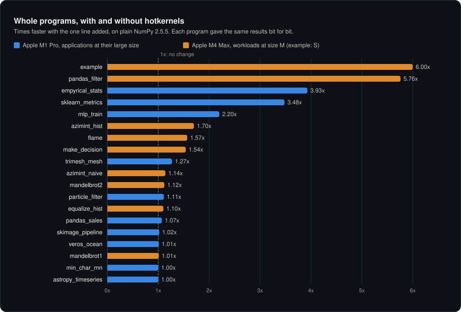

# hotkernels

Fast kernels for the NumPy operations where NumPy is slow, delivered as a zero-friction drop-in: hand-written assembly where it can actually win, plain C where the compiler is already enough.

```python
import hotkernels
hotkernels.install()
```

Kernels are written by coding agents iterating against a judge. The judge checks every kernel against NumPy and times it against NumPy and naive `clang -O3` C.

There are 49 kernels, for 23 NumPy operations and four functions of bottleneck, on two architectures written separately against the same specs: ARM64 NEON for Apple Silicon, and x86-64 AVX2 for Linux on processors of the x86-64-v3 level. Forty-seven return NumPy's result, or bottleneck's, bit for bit, and are what `install()` installs; the two float `np.cumsum` kernels are within a declared tolerance and are installed on request.

Which calls are served, on which element types and under what conditions, is in [Getting started](https://sofeikov.github.io/hotkernels/start/#what-gets-faster). How each kernel works, and where assembly could not win, is in [docs/kernel-findings.md](docs/kernel-findings.md).

## Results

**What a program gains depends on how much of its time is spent in calls a kernel takes: from nothing to 6x in the nineteen programs measured.** A single NumPy call gains more, and the sections below go from whole programs down to single calls and then to the kernels themselves. Every figure is from native hardware and is given with its machine and size.

### Whole programs

Programs run unmodified, on plain NumPy and again after `hotkernels.install()`, with the results compared bit for bit:



| Program | What it does | Machine | Size | NumPy | With hotkernels | Faster by |
|---|---|---|---|---|---|---|
| `example` | [examples/workload.py](examples/workload.py): clean a signal, summarise an image, look up ids (ours) | M4 Max | S | 31 ms | 5.17 ms | 6.00x |
| `pandas_filter` | pandas: `s[s > 0]` on a float64 Series | M4 Max | M | 117 ms | 20.4 ms | 5.76x |
| `empyrical_stats` | empyrical: risk and return statistics of daily return series | M1 Pro | 6 series of 50,400 daily returns | 1,303.5 ms | 331.7 ms | 3.93x |
| `sklearn_metrics` | scikit-learn: ROC, precision-recall, calibration, confusion matrix | M1 Pro | 1,000,000 binary predictions, 300,000 over 10 classes | 994.6 ms | 285.8 ms | 3.48x |
| `mlp_train` | Training a two-layer perceptron by mini-batch gradient descent (ours) | M1 Pro | 12,000 examples of 784 inputs, 256 hidden units, 2 epochs | 311.5 ms | 141.4 ms | 2.20x |
| `azimint_hist` | NPBench: mean intensity per radial bin, by two histograms | M4 Max | M | 81.9 ms | 48.3 ms | 1.70x |
| `flame` | A fractal flame renderer (ours) | M4 Max | M | 99 ms | 63.2 ms | 1.57x |
| `make_decision` | numpy-benchmarks: nearest of 32 symbols for each sample, by `np.argmin` | M4 Max | M | 90.6 ms | 58.7 ms | 1.54x |
| `trimesh_mesh` | trimesh: build, measure, sample, section and subdivide a triangle mesh | M1 Pro | 81,920 faces, 200,000 surface samples | 179.6 ms | 141 ms | 1.27x |
| `azimint_naive` | NPBench: mean intensity per radial bin, one mask per bin | M4 Max | M | 94.6 ms | 82.7 ms | 1.14x |
| `mandelbrot2` | NPBench: escape-time Mandelbrot set, escaped points dropped | M4 Max | M | 115 ms | 102 ms | 1.12x |
| `particle_filter` | A bootstrap particle filter tracking a target (ours) | M1 Pro | 100,000 particles, 100 steps | 895.4 ms | 804.1 ms | 1.11x |
| `equalize_hist` | scikit-image: `exposure.equalize_hist` on a float64 image | M4 Max | M | 103 ms | 93.3 ms | 1.10x |
| `pandas_sales` | pandas: filters, group-by, pivot, resample, rolling, merge on a table of sales | M1 Pro | 2,000,000 sales in 200 stores over 365 days | 477.6 ms | 446.5 ms | 1.07x |
| `skimage_pipeline` | scikit-image: CLAHE, Otsu, labels, region properties, Canny, HOG | M1 Pro | 4 images of 1,024 × 1,024 | 1,180.2 ms | 1,152.8 ms | 1.02x |
| `veros_ocean` | Three routines of the Veros ocean model, from pyhpc-benchmarks | M1 Pro | a grid of 204 × 204 × 26 points | 491.1 ms | 488.1 ms | 1.01x |
| `mandelbrot1` | NPBench: escape-time Mandelbrot set, masks over the whole grid | M4 Max | M | 106 ms | 105 ms | 1.01x |
| `min_char_rnn` | Karpathy's min-char-rnn.py, a character-level recurrent network | M1 Pro | 300 iterations, 100 hidden units, a vocabulary of 1,000 | 1,626.3 ms | 1,623.9 ms | 1.00x |
| `astropy_timeseries` | Astropy: sigma clipping, biweight, Lomb–Scargle periodograms, Bayesian blocks | M1 Pro | 10 light curves of 5,000 points, 4 images of 1,024 × 1,024 | 1,534.9 ms | 1,529.3 ms | 1.00x |

- **Apple M1 Pro rows** are ten applications at the larger of their two sizes: `uv run --group apps delivery apps --profile --record` and the same with `--set second`, the best of 7 alternating rounds, at load averages of 2.95 and 3.41, so the times are rough. At their smaller sizes the ten gain 1.00x to 3.52x. Both sizes, the calls each program makes and where its time goes are in [delivery/results/apple-m1-pro-apps.md](delivery/results/apple-m1-pro-apps.md) and [apple-m1-pro-apps-second.md](delivery/results/apple-m1-pro-apps-second.md), and what follows from them in [docs/applications-findings.md](docs/applications-findings.md) and [docs/applications-second-findings.md](docs/applications-second-findings.md).
- **Apple M4 Max rows** are nine workloads from `uv run --group workloads delivery workloads --record`, the best of alternating runs, at a load average of 2.12. A workload's size is set by its run time: M is about 100 ms on plain NumPy and S about 10 ms. Both sizes are in [delivery/results/apple-m4-max-workloads.md](delivery/results/apple-m4-max-workloads.md); the design is [docs/workloads-design.md](docs/workloads-design.md), and the nightly runs are drawn on the site's [Over time](https://sofeikov.github.io/hotkernels/report/history/) page.
- **"Ours" marks a program written in this repository.** The others are libraries called as a user calls them, or published benchmarks copied unchanged. `examples/workload.py` was written to show the effect of the one line and uses eleven of the served operations; on the M1 Pro, on two million elements, it runs in 45 ms on plain NumPy and 8.4 ms with hotkernels.
- **Ten of the nineteen gain under 1.15x.** Where their time goes instead, program by program, is in the findings documents above.
- **No whole program has been timed on x86-64** ([issue 205](https://github.com/sofeikov/hotkernels/issues/205)).

### NumPy calls from Python

One Python statement, timed from call to result on plain NumPy and after `hotkernels.install()`. The figure is how many times faster the statement is, on arrays of 16 and of 1,048,576 elements:

| Statement | Elements | M1 Pro: 16 | M1 Pro: 1,048,576 | M4 Max: 1,048,576 | i5-14600KF: 16 | i5-14600KF: 1,048,576 |
|---|---|---|---|---|---|---|
| `np.argmax(x)` | float32 | 13.2x | 8.89x | 9.38x | 15.1x | 1.88x |
| `x.argmax()` | float32 | 2.98x | 8.89x | 9.48x | 3.86x | 1.79x |
| `np.clip(x, -0.5, 0.5)` | float32 | 11.1x | 11.3x | 5.39x | 7.47x | 1.04x |
| `np.clip(x, -0.5, 0.5)` | float64 | 9.81x | 4.69x | 2.55x | 6.88x | 1.05x |
| `x[mask]`, half selected | float32 | 2.48x | 30.7x | 28.6x | 2.50x | 14.7x |
| `x[mask]`, half selected | float64 | 2.53x | 16.3x | 16.6x | 2.43x | 10.1x |
| `x[mask] = 0.0`, half selected | float64 | 5.19x | 20.7x | 21.9x | 7.42x | 17.7x |
| `np.nonzero(mask)`, few selected | bool | 1.25x | 13.4x | 13.1x | 1.23x | 12.3x |
| `np.nonzero(m)`, rows of 22, few True | bool | 1.27x | 26.9x | — | — | 24x |
| `np.cumsum(x)` | int64 | 1.94x | 12.3x | 11.2x | 1.96x | 5.98x |
| `x.astype(np.float32)` | uint8 | 1.90x | 5.15x | 5.89x | 2.01x | 1.04x |
| `np.sum(x)` | uint8 | 29.4x | 15.6x | 14.7x | 37.0x | 41.7x |
| `np.count_nonzero(x)` | float64 | 3.34x | 3.78x | 3.34x | 3.06x | 4.28x |
| `np.histogram(x, 50, (-3.0, 3.0))` | float64 | 6.13x | 9.33x | 8.77x | 6.18x | 7.21x |
| `np.bincount(x)` | uint8 | 2.27x | 6.75x | 6.94x | 2.92x | 4.13x |
| `np.isin(x, eight_values)` | int64 | 72.6x | 18.2x | 15.9x | 67.9x | 34.6x |
| `np.searchsorted(a, v)` | float64 | 1.49x | 8.83x | 8.05x | 1.49x | 3.94x |
| `np.searchsorted(a, v, side='right')` | float64 | 1.45x | 7.71x | 7.93x | 1.46x | 3.66x |
| `np.digitize(x, bins)`, 1,000 bin edges | float64 | 1.10x | 26.8x | 28.0x | 1.13x | 4.76x |
| `np.interp(x, xp, fp)` | float64 | 5.61x | 21.0x | 15.8x | 3.73x | 5.58x |
| `np.cumsum(mask)`, half True | bool | 2.77x | 19.2x | — | 3.01x | 9.05x |
| `np.maximum.accumulate(x)` | int64 | 2.93x | 14.2x | — | 2.63x | 5.19x |
| `np.fmax.accumulate(x)` | float64 | 2.85x | 12.7x | — | 2.72x | 5.07x |
| `np.fmax.reduceat(x, starts)`, runs of 16, 5% NaN | float64 | 3.46x | 3.05x | — | 2.58x | 12.0x |
| `m.any(axis=1)`, rows of 22 | bool | 5.52x | 24.0x | — | 5.10x | 42.6x |
| `np.bincount(x)`, codes 0 to 63 | int16 | 4.48x | 9.44x | — | 3.88x | 4.54x |
| `np.bincount(x)`, codes 0 to 63 | int64 | 2.71x | 4.26x | — | 2.27x | 1.93x |
| `np.where(c, a, b)`, half true | float64 | 4.79x | 1.60x | — | 4.64x | 5.92x |

Apple M1 Pro, Apple M4 Max and Intel Core i5-14600KF, NumPy 2.5.5 on each. `uv run delivery time --record`, at load averages of 2.19, 2.02 and 0.81; on the Intel machine the timing thread is pinned to a performance core. The row for `np.nonzero(m)` on a matrix is from later runs of `uv run delivery time --only nonzero`. A dash is a statement not in that machine's recorded run. Every statement at 16, 4,096 and 1,048,576 elements, with its times, is in [delivery/results/apple-m1-pro.md](delivery/results/apple-m1-pro.md), [apple-m4-max.md](delivery/results/apple-m4-max.md) and [intel-r-core-tm-i5-14600kf.md](delivery/results/intel-r-core-tm-i5-14600kf.md).

- **At 16 elements most of the gain is NumPy's own call path being skipped, not the kernel.** `np.clip(x, -0.5, 0.5)` on 16 elements takes 1.3 µs on plain NumPy on the M1 Pro, nearly all of it NumPy's Python wrapper and ufunc machinery, and about 120 ns with hotkernels, which calls the kernel before any of that runs when the bounds are plain numbers and there is no `out`, or `out` is `x` itself.
- **NumPy is a different opponent on x86-64.** It has AVX2 loops of its own for `argmax`, `clip` and `astype` there, so at a million elements those gain 1.0x to 1.9x there, far less than on Apple Silicon.
- **A call no kernel takes costs under a nanosecond more**, or a percent or so where a hook has to read its arguments. On the M1 Pro `x[3]` takes 66.7 ns on plain NumPy and 66.6 ns with hotkernels installed; `np.clip(x, -0.5, None)` takes 1.02 µs and 1.04 µs.
- **`np.searchsorted` and `np.interp` are timed with as many needles as elements**, and `np.digitize` with 1,000 bin edges. With a sorted array of 1,000 elements and a million needles `np.searchsorted` is 27x faster on either side on the M1 Pro and `np.interp` 19x; on the i5-14600KF they are 4.9x, 4.8x on the right side, and 3.6x.
- **Checked from Python.** 403,023 calls on each architecture, to NumPy and to bottleneck, give the same result, exceptions and warnings with hotkernels as without, and NumPy's own test suite gives the same outcome for each of its 47,234 tests.

### The kernels as native functions

The judge times each kernel as a native function, against NumPy and against the same loop written in plain C and compiled with `clang -O3`. How many times faster than NumPy each is on an array of 1,048,576 elements, where the fixed cost of a call no longer matters:


| NumPy call | Elements | M1 Pro: vs NumPy | M1 Pro: vs `clang -O3` | M4 Max: vs NumPy | i5-14600KF: vs NumPy |
|---|---|---|---|---|---|
| `m.any(axis=0)`, rows of 31 | bool | 40.5x | 18.0x | — | 37.5x |
| `np.cumsum(x)` | float32 | 29.0x | 7.83x | 20.1x | 13.3x |
| `np.unique(x)`, labels | int64 | 25.4x – 40.0x | 0.98x – 1.57x | — | 70.4x – 83.2x |
| `np.nonzero(m)`, rows of 22 | bool | 22.5x – 35.7x | 3.67x – 14.0x | — | 20.3x – 40.2x |
| `np.cumsum(x)` | float64 | 20.1x | 5.48x | 17.4x | 6.09x |
| `x[mask]` | float32 | 17.3x – 41.7x | 2.70x – 5.70x | 15.6x – 40.4x | 12.6x – 32.7x |
| `np.argsort(x, kind="stable")` | int64 | 17.3x – 64.9x | ships as the C | — | — |
| `np.interp(x, xp, fp)` | float64 | 16.8x | 6.40x | 16.5x | 10.6x |
| `np.sum(x)` | uint8 | 15.7x | 5.07x | 14.0x | 42.1x |
| `np.fmax.accumulate(x)` | float64 | 15.4x – 18.2x | 11.2x – 13.1x | — | 4.85x – 7.00x |
| `np.argsort(x, kind="stable")` | uint64 | 14.7x – 78.0x | ships as the C | — | — |
| `m.any(axis=1)`, rows of 22 | bool | 14.6x – 38.7x | 8.68x – 8.70x | — | 50.8x – 57.1x |
| `np.argsort(x, kind="stable")` | float64 | 13.4x – 17.6x | ships as the C | — | — |
| `np.cumsum(mask)` | bool | 12.9x | 2.06x | — | 11.9x |
| `np.cumsum(x)` | int64 | 12.5x | 1.95x | 11.2x | 5.34x |
| `np.maximum.accumulate(x)` | int64 | 11.1x – 11.3x | 2.83x – 2.90x | — | 5.53x – 5.97x |
| `x[mask]` | float64 | 11.0x – 22.5x | 1.67x – 4.10x | 11.4x – 24.3x | 9.38x – 16.6x |
| `np.histogram(x, bins, range)` | float64 | 9.70x | 3.59x | 8.55x | 7.49x |
| `np.argmax(x)`, `np.argmin(x)` | float32 | 8.82x, 8.86x | 26.6x, 26.7x | 9.57x, 9.17x | 1.90x, 1.90x |
| `np.clip(x, lo, hi)` | float32 | 7.62x – 11.0x | 1.00x – 1.44x | 3.83x – 5.38x | 0.65x – 6.39x |
| `x[mask] = value` | float64 | 7.48x – 21.4x | 4.64x – 19.0x | 11.1x – 23.6x | 7.30x – 18.4x |
| `np.searchsorted(a, v, side='right')` | float64 | 6.89x | 12.8x | 1.46x | 6.58x |
| `np.argmax(x)`, `np.argmin(x)` | float64 | 6.86x, 7.10x | 12.7x, 13.2x | 7.76x, 7.46x | 1.72x, 1.87x |
| `np.bincount(x)` | uint8 | 6.74x | 1.31x | 6.78x | 4.18x |
| `np.searchsorted(a, v)` | float64 | 6.40x | 8.83x | 1.48x | 6.19x |
| `np.bincount(x)` | int16 | 6.39x – 13.2x | 1.71x – 7.13x | — | 3.53x – 6.07x |
| `np.nonzero(mask)` | bool | 5.15x – 19.2x | 2.47x – 8.08x | 3.71x – 21.6x | 3.16x – 19.8x |
| `np.bincount(x)` | int64 | 4.97x – 8.96x | 1.25x – 3.52x | — | 2.32x – 3.75x |
| `np.count_nonzero(x)` | float64 | 3.79x | 1.28x | 3.44x | 4.36x |
| `np.clip(x, lo, hi)` | float64 | 3.78x – 5.06x | 1.01x – 1.35x | 1.92x – 2.69x | 0.70x – 1.23x |
| `np.count_nonzero(x)` | int64 | 3.25x | 1.03x | 3.36x | 1.26x |
| `np.sum(x)` | float32 | 3.22x | 1.64x | — | 1.79x |
| `x.astype(np.float32)` | uint8 | 2.68x | ships as the C | 4.41x | 1.05x |
| `np.sum(x)` | float64 | 1.86x | 1.10x | — | 1.56x |
| `np.isin(x, test)` | int64 | 1.83x – 75.6x | 1.00x – 5.34x | 1.57x – 68.2x | 3.78x – 39.8x |
| `np.searchsorted(a, v, side='right')` | int64 | 1.76x | 5.06x | — | 1.48x |
| `np.searchsorted(a, v)` | int64 | 1.72x | 4.59x | — | 1.45x |
| `np.where(c, a, b)` | float64 | 1.56x | 1.32x – 1.34x | — | 1.54x – 5.53x |
| `np.fmax.reduceat(x, starts)`, one run | float64 | 1.02x | 6.55x – 6.56x | — | 1.21x – 1.22x |
| `x[mask]` | uint8, int8, bool | — | ships as the C | — | 21.5x – 79.6x |
| `x[mask]` | int16, uint16 | — | ships as the C | — | 18.4x – 59.2x |
| `x[mask] = value` | float32, int32 | — | ships as the C | — | 10.9x – 35.8x |
| `np.isin(x, test)` | int32 | — | ships as the C | — | 5.28x – 108x |

Apple M1 Pro and Apple M4 Max with Apple clang 21, Intel Core i5-14600KF on Linux with clang 21.1.8, NumPy 2.5.5 on each. One `uv run judge run <kernel> --record` per kernel; the reports are in [`results/`](results), and every size from 16 to 16,777,216 elements, with confidence intervals, is in [docs/kernel-findings.md](docs/kernel-findings.md).

- **On the M1 Pro all 41 kernels measured there are faster than NumPy at every size measured.** At a million elements the low end of the row is above 5x for 29 of the 41.
- **A range covers the cases a kernel is timed in:** 5% and 50% of the elements selected for the mask kernels, test values close together or far apart for `isin`, several pairs of bounds and kinds of data for `clip`, few and many True for `any`, codes spread over 64 or 1,000 counters or four values for `bincount`, random, rising and 5% NaN data for the running maxima, half or 95% of the condition True for `np.where`, 2 or 10 distinct values in a range of 10 or 256 for `np.unique`, and for `argsort` keys that differ in all their bits at the low end and values below 1,000 at the high end. `np.searchsorted` and `np.interp` are shown with 1,000 needles.
- **The second column is the one that says whether assembly was worth writing.** A kernel keeps its assembly only if the judge finds it significantly faster than the compiled C; "ships as the C" marks one that did not, on ARM64. The same comparison on x86-64, over all sizes, is in [docs/kernel-findings.md](docs/kernel-findings.md#x86-64).
- **A dash in an M1 Pro cell** is a kernel that has assembly on x86-64 only and ships as its C on ARM64, where the judge has not timed it. **A dash in an M4 Max cell** is a kernel added after that machine's run. The stable `argsort` kernels are one C source for both architectures and appear here for the M1 Pro only.
- **NumPy is a different opponent on x86-64**, with vector loops of its own for several of these calls, and memory is the ceiling sooner, so the two architectures' figures are not expected to agree. `np.clip` shows both: at this size on the i5-14600KF single runs differ by up to 20%, and in the recorded run the float32 kernel is level with NumPy for bounds of (-0.5, 0.5) on random data, behind it on rounded data and ahead of it on data with a few negative zeros. Across sizes it is 1.7x faster at 65,536 elements and 2.0x at 16,777,216 ([docs/kernel-findings.md](docs/kernel-findings.md#sum-count_nonzero-clip-astype)).
- **On the M4 Max most figures are within 15% of the M1 Pro's.** Lower: `np.clip` by about half on both types, `np.searchsorted` from 6.40x to 1.48x, float32 `np.cumsum` from 29.0x to 20.1x. For `np.clip` and `np.searchsorted` the lead over the C is about the same on both machines, so NumPy is what got faster there; why has not been established.
- **How the runs were taken.** On the M1 Pro the `np.searchsorted`, `np.interp` and `np.clip` rows on float32 and float64 are each the mean of ten runs on a machine that was not fully quiet (load average about 3); the other rows are single runs, and the rows for `np.unique` (load average 22) and `argsort` (6 to 13) were taken on a busy machine and are rough. The M4 Max runs were at 1.3 to 1.9, and the i5-14600KF's pass over its first 23 kernels at 0.5 to 1.2. Some runs were made `--unlocked`, because the kernel's spec arrived in the same pull request as its assembly; each report says so. The x86-64 figures are the ones in [docs/kernel-findings.md](docs/kernel-findings.md#x86-64), with the reports supplying the cases its table does not list.
- **Other shapes are in the findings.** `m.any(axis=1)` on rows of 4 is 141x to 278x faster than NumPy on the M1 Pro and on rows of 64 6.44x to 22.0x; `m.any(axis=0)` on rows of 8 is 99x faster, on rows of 64 19x and on rows of 256 5.1x. With 64 needles `np.searchsorted` on float64 is 2.3x faster than NumPy and `np.interp` 15.7x, and a call that short is partly NumPy's fixed cost. `np.fmax.reduceat` is timed here as one run over the whole array, where the kernel and NumPy's loop both run at the speed of the caches; on runs of 16 it is the row in the table from Python.

### What stands behind the numbers

- **Checked against NumPy, not against a description of it.** Every kernel is compared with NumPy's own output on inputs that include NaN, infinities, signed zeros, ties and denormals. Forty-seven of the 49 match bit for bit, 43 of them NumPy and 4 the functions of bottleneck they stand in for. The two float `cumsum` kernels regroup the additions, which is where their speed comes from, and stay within a declared error bound.
- **Memory-safe by test.** Each kernel runs with its buffers placed against inaccessible pages, so reading or writing one byte outside them crashes the check.
- **Assembly only where it wins.** A kernel keeps its assembly only if the judge finds it significantly faster than the compiled C. `astype` from `uint8` to `float32` did not pass that bar on ARM64 and ships as C there. The three stable `argsort` kernels ship as C as well: their gain is a radix sort in place of NumPy's merge sort, and the hand-written form of their one hot loop tied the compiler's.

### What the numbers do not say

- **The kernel table times native functions.** From Python a call also pays for NumPy's call path and, for `x[mask]` and `np.nonzero`, for allocating the result. Those figures are under [NumPy calls from Python](#numpy-calls-from-python).
- **Float `np.cumsum` is installed only on request.** It is not bit-identical to NumPy and its output is not monotonic for non-negative input, so it needs `hotkernels.install(inexact=True)`.
- **Two results depend on the arguments.** `np.isin` is fast when the test values all lie between 0 and 65,534 or within 32,767 of the first one, and ties the C otherwise. On ARM64 `np.clip` with a lower bound of zero, as in `np.clip(x, 0, 1)`, is about 1.3x over the C in cache when the data holds no negative zeros and runs at the speed of the C when one occurs in the first few thousand elements; with an upper bound of `-0.0` it always runs at the speed of the C. Those cases are timed, and are the low ends of those rows.
- **Scalar arguments are verified for the values each spec lists.** `np.clip` is checked with twelve pairs of bounds and `np.histogram` with sixteen bin counts and ranges, not with every possible one.
- **Three machines, one run each for most figures.** Two Apple Silicon machines and one x86-64 processor, several of the runs on a machine in use. On x86-64 the search kernels use gathers, which are fast on the i5-14600KF and slow on some other processors.

## What is here

- **The judge** (`judge/`): checks a kernel for correctness and memory safety, and reports how fast it is. It runs on macOS ARM64 and on Linux x86-64.
- **Fixture kernels** (`judge/fixtures/`): `argmax_f32`, `compress_f32`, `compress_scratch_f32`, `tally_u8` and `rank_u8`, used to test the judge itself, each with an ARM64 and an x86-64 version.
- **The survey** (`survey/`): measures NumPy against naive C per operation, to decide which kernels are worth writing. It runs on macOS ARM64 and on Linux x86-64. Recorded results for both are in `survey/results/`.
- **Kernels** (`kernels/`): 49 kernels for 23 NumPy operations and four functions of bottleneck, each with a spec, a naive C reference and, where assembly beats the C, an assembly version per architecture: 37 for ARM64 and 42 for x86-64. Each kernel's `attempts.md` lists every optimisation tried, kept or not.
- **The package** (`hotkernels/`): what a user installs. A C extension points NumPy at the kernels, and `install()`, `uninstall()`, `enabled()` and `report()` control it. `install()` installs the 43 kernels that return NumPy's result bit for bit, and the 4 that return bottleneck's for its `nanmean`, `nanstd`, `nanmin` and `nanmax` once bottleneck is imported (pandas and empyrical call them instead of NumPy's); `install(inexact=True)` the other two.
- **The delivery tool** (`delivery/`): tests and times the package from Python. Recorded timings are in `delivery/results/`.
- **A prototype of a lazy NumPy layer** (`prototypes/lazy/`): the design in [docs/lazy-design.md](docs/lazy-design.md) written out to be read and tried, with its tests in `tests/test_lazy_prototype.py` and `tests/test_lazy_graphs.py`. With it, fusion ([docs/lazy-fusion-design.md](docs/lazy-fusion-design.md)): eighty kernels in `prototypes/lazy/kernels/`, fourteen written by hand and the rest by `prototypes/lazy/make_kernel.py` from the names of their shapes, which compute a whole expression in one pass, block by block; checked by the judge and tested in `tests/test_lazy_fusion.py` and `tests/test_lazy_at_once.py`. None of it is part of the package.
- **An example** (`examples/workload.py`): a NumPy program written without hotkernels in mind, used to show the effect of the one line.
- **Release tooling** (`release/`, `release-notes/`): the notes each pull request leaves, and the commands that turn them into a release. Publishing to PyPI runs in [`.github/workflows/release.yml`](.github/workflows/release.yml).
- **The documentation site** (`docsite/`): the pages published at [sofeikov.github.io/hotkernels](https://sofeikov.github.io/hotkernels/), with a technical report on how all of this works. Its figures are read from the files above when it is built.

Supported platforms for the package, the judge and the survey: macOS on Apple Silicon (ARM64), and Linux on x86-64. On Linux the package needs a processor with the x86-64-v3 instruction sets (AVX2, FMA, BMI1, BMI2, LZCNT, MOVBE, POPCNT: Intel since 2013, AMD since 2015).

## Using hotkernels

```bash
pip install hotkernels
```

Wheels are published for macOS on Apple Silicon and for Linux on x86-64 (glibc), CPython 3.11 to 3.14. Elsewhere the package installs from its source distribution without a compiler, and `install()` does nothing. In this repository, `uv sync` builds the package from `kernels/`; that needs the Xcode command line tools on macOS, or a C compiler and GNU binutils on Linux.

```python
import numpy as np
import hotkernels

hotkernels.install()            # NumPy now uses the kernels, in the whole process

x = np.random.standard_normal(1_000_000)
x[x > 0]                        # served by a kernel
np.clip(x, 0, 1)                # served by a kernel
x[::2].sum()                    # not something a kernel handles: NumPy does it, as before

print(hotkernels.report())      # what is installed, and how often each kernel ran
hotkernels.uninstall()          # NumPy is exactly as it was
```

- `hotkernels.install(inexact=True)` also installs the kernels that are not bit-identical to NumPy.
- `with hotkernels.enabled():` installs for the duration of a block, and puts hotkernels back as it found it when the block ends; it takes the same arguments as `install()`.
- A kernel takes a call only when the array is a plain contiguous `ndarray` of its element type and every other argument is one it implements. Any other call goes to NumPy as it was written.
- On any other platform, and on an x86-64 processor without the x86-64-v3 instruction sets, `install()` does nothing and `report()` says why.
- `python -m hotkernels script.py [args ...]` runs an unmodified script with hotkernels installed; `-m module` runs a module, and `--report` prints the report at the end.

## Using the judge

Requires [uv](https://docs.astral.sh/uv/) and a C toolchain: the Xcode command line tools on macOS, or clang and GNU binutils on Linux x86-64.

```bash
uv run judge selftest            # prove the judge catches known-bad kernels
uv run judge check argmax_f32    # lint and correctness for one kernel
uv run judge run argmax_f32      # correctness, then a timing report
```

## Using the survey

```bash
uv run survey run                 # measure every candidate; takes 3 to 15 minutes, by machine
uv run survey run --only argmax   # measure the candidates whose name matches
uv run survey report survey/results/apple-m1-pro.json   # regenerate a report
```

## Using the delivery tool

```bash
uv run delivery check         # every hooked call, with and without hotkernels; one process per core, about a minute
uv run delivery check --jobs 1   # the same in one process, for a crash in a kernel; about 4.5 minutes
uv run delivery demo          # run examples/workload.py both ways and compare
uv run delivery time          # time statements from Python; add --record to keep the result
uv run --group workloads delivery workloads   # library and benchmark-suite code, both ways
uv run --group workloads delivery workloads --size M,L --history DIR   # also keep the run under DIR/history/
uv run delivery history       # the kept runs of this machine, from the perf-history branch
uv run delivery numpy-tests   # NumPy's own test suite, both ways at once; about a minute, and CI runs it
uv run --group apps delivery apps --profile   # five whole applications at two sizes, both ways, and where their time goes
uv run --group apps delivery apps --set second --profile   # five more, recorded apart
```

## Using the documentation site

```bash
uv run docsite serve   # build the site and serve it at http://127.0.0.1:8000, rebuilding on change
uv run docsite build   # build it into build/site
```

Pages are Markdown under `docsite/pages/` and are listed in `docsite/site.toml`. The page "Over time" draws the workload runs on the `perf-history` branch; run `git fetch origin perf-history` first, or the page shows no runs.

## Using the self-hosted runners

The macOS jobs of a pull request run on the maintainer's own Mac when it is online, and on GitHub's runners otherwise. GitHub's macOS runners are often not assigned for a quarter of an hour, after which a job fails. A pull request from a fork and a tag always use GitHub's runners, so a published wheel never comes from that Mac.

`ci.yml` spends those runners only where its result will be read:

- A newer push to a pull request cancels its unfinished run. On `main` the running run finishes and a newer push replaces the one still waiting.
- A change to documentation alone (Markdown anywhere, `docs/`, `docsite/`) skips the test jobs; they show as skipped.
- On a pull request, `numpy-range` runs only when the change touches what it checks on ARM64. The rules are in [`.github/scripts/ci-scope.sh`](.github/scripts/ci-scope.sh).
- To run every job on any branch: `gh workflow run ci.yml --ref <branch>`.

The same Mac runs `.github/workflows/nightly.yml` at 02:00 UTC: it times the workloads and pushes the run to the `perf-history` branch. A night when the Mac is offline or busy has no run.

To set the runners up on a Mac with Apple Silicon:

```bash
sudo sysadminctl -addUser ci-runner -fullName "CI Runner" -password -   # once: a standard account for the jobs
.github/runners/setup.sh 4        # install four runners, so four jobs run at once
.github/runners/setup.sh 6        # run again with a larger count to add runners; installed ones are left running
.github/runners/setup.sh remove   # remove them again
```

- **They start by themselves** at boot and after a system update, as system services under the `ci-runner` account. With FileVault on, that is once someone has logged in at the Mac's login screen.
- **`RUNNER_STATUS_TOKEN`** is a repository secret the workflows use to see whether a runner is online: a fine-grained personal access token for this repository with read access to Administration. Store it with `gh secret set RUNNER_STATUS_TOKEN`. When it is missing or expired, every job goes to GitHub's runners.
- **Asleep, switched off or away**, the Mac is skipped and jobs go to GitHub's runners. GitHub forgets a runner that has not connected for about two weeks; run the setup again then.
- **The repository is public.** Under Settings, Actions, General, set "Fork pull request workflows" to require approval for all external contributors, so that nobody else's pull request can run on the Mac.

[`pick-runner.yml`](.github/workflows/pick-runner.yml) is the workflow that chooses.

## Making a release

Each pull request that changes the package leaves a note in `release-notes/upcoming/` (see [AGENTS.md](AGENTS.md#release-notes)). To release:

```bash
uv run release prepare 0.2.0   # set the version and compile the notes into release-notes/0.2.0.md
```

Write the highlights at the top of that file, re-measure on native hardware, and merge it as a pull request. Then, on an up-to-date `main`:

```bash
uv run release tag             # tag the merged commit v0.2.0 and push the tag
```

The tag starts the release workflow, which builds and tests the wheels and waits for the maintainer to approve the `pypi` deployment before uploading. [docs/release-design.md](docs/release-design.md) has the details.

## Documentation

- [sofeikov.github.io/hotkernels](https://sofeikov.github.io/hotkernels/): getting started, and the technical report with interactive figures
- [docs/core-design.md](docs/core-design.md): what the project is building and why
- [docs/judge-design.md](docs/judge-design.md): how kernels are checked and timed
- [docs/survey-design.md](docs/survey-design.md): where NumPy is slow, and which kernels to build in what order
- [docs/kernel-findings.md](docs/kernel-findings.md): what each kernel achieves, how, and where assembly could not win
- [docs/delivery-design.md](docs/delivery-design.md): how the kernels reach unmodified NumPy code: the binding, `install()` and `report()`, and how they are tested
- [docs/applications-findings.md](docs/applications-findings.md): what five whole NumPy programs gain from `install()`, where their time goes, and the gaps that follow; designed in [docs/applications-design.md](docs/applications-design.md). Five more are in [docs/applications-second-findings.md](docs/applications-second-findings.md)
- [docs/workloads-design.md](docs/workloads-design.md): library and benchmark-suite code run both ways, and how the runs are kept over time ([docs/workloads-history-design.md](docs/workloads-history-design.md))
- [docs/second-shortlist-design.md](docs/second-shortlist-design.md): the second set of kernels, taken from the NumPy calls of a program in use
- [docs/sort-design.md](docs/sort-design.md), [docs/unique-design.md](docs/unique-design.md), [docs/median-large-design.md](docs/median-large-design.md), [docs/accumulate-rows-design.md](docs/accumulate-rows-design.md), [docs/gradient-step-findings.md](docs/gradient-step-findings.md): the calls served by a different algorithm or by a loop of the binding's own: stable `argsort`, `np.unique`, `np.median`, accumulations down the columns of a matrix, and `w -= b`
- [docs/coverage-gaps-design.md](docs/coverage-gaps-design.md): the calls a production pipeline made that no kernel took, which of them get a kernel and which do not
- [docs/two-sizes-design.md](docs/two-sizes-design.md): a second length for `np.searchsorted` and `np.interp`, so their kernels can serve real calls
- [docs/release-design.md](docs/release-design.md): how a release is made and published, and who can publish
- [docs/x86-64-design.md](docs/x86-64-design.md): the second architecture: what to target, what changes, and how the kernels are carried over
- [docs/lazy-design.md](docs/lazy-design.md): a proposal for a lazy array type, `hotkernels.get_lazy()`, whose graph is what fusing operations would need
- [docs/lazy-fusion-design.md](docs/lazy-fusion-design.md): fusion by pattern on that graph: which expressions kernels may compute, how an expression is run block by block with a kernel for every step, the eighty kernels, what twenty-six programs gain or lose, and what is left to gain on them
- [docs/distribution-design.md](docs/distribution-design.md): what a release contains: wheels, the source distribution, other platforms, `python -m hotkernels`
- [AGENTS.md](AGENTS.md): rules for coding agents working in this repository
- [kernels/README.md](kernels/README.md): how to add a kernel

## Licence

MIT
