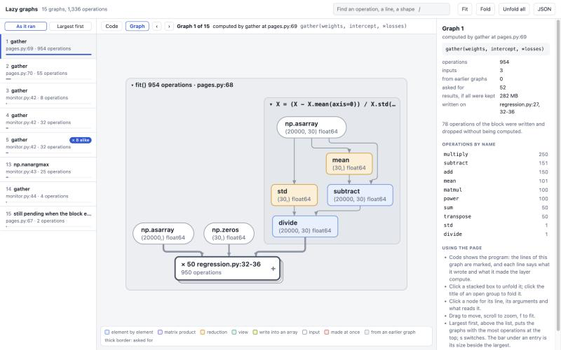

# A lazy NumPy layer: `hotkernels.get_lazy()`

This is a proposal for review. Nothing here is in the package. A prototype that follows this document is in [`prototypes/lazy/`](../prototypes/lazy), with tests in [`tests/test_lazy_prototype.py`](../tests/test_lazy_prototype.py); it is there to be read and argued with, and [What was verified](#what-was-verified) says what it showed. Getting the graph out and drawing it have documents of their own: [lazy-recording-design.md](lazy-recording-design.md) and [lazy-graph-page-design.md](lazy-graph-page-design.md).

The document covers the smallest build that is worth having: NumPy code whose operations are written down as a graph instead of being computed, and computed when the user asks. **It makes nothing faster and is not meant to.** Speed is out of scope here. The graph is what fusion needs, and fusion is what a kernel for a whole expression needs; [What the graph is for](#what-the-graph-is-for) says how the three connect, without planning the second and third.

[core-design.md](core-design.md#later) left fusion for later because it "cannot be delivered transparently", and [gradient-step-findings.md](gradient-step-findings.md#can-a-hook-fuse-the-statement) found why: no hook sees an expression whole, and a result that has no values yet is unsound for a real `ndarray`. The delivery design named the other road in its first table: an array type of the project's own reaches anything, in code that has opted in. This document designs that type, and keeps the opting in to one line.

## Summary

- **One line turns it on, one call gets the values.** `np = hotkernels.get_lazy()` stands where `import numpy as np` stood, and `x.gather()` returns an ordinary `numpy.ndarray`.
- **Nothing is patched.** `get_lazy()` returns an object, and the line binds it to a name in the module that wrote it. The `numpy` module, `sys.modules` and every other module's import are as they were, so it does not matter what was imported before or in which order. See [One line, and nothing is patched](#one-line-and-nothing-is-patched).
- **The code in between stays NumPy code.** Operators, `np.exp(x)`, `x.mean(axis=0)`, `X.T @ r`, slicing. No new functions to learn.
- **A lazy array is a type of its own, `hotkernels.LazyArray`, not an `ndarray`.** Element types do not change: `x.dtype` is NumPy's. [Types](#types-what-changes-for-the-user) says where the new type shows in a program and what a user has to change: nothing to run, one thing if their code asks `isinstance(x, np.ndarray)`.
- **NumPy itself delivers the calls.** It hands every call that meets such a type to it, through two protocols it provides for the purpose. That reaches operators, ufuncs, functions, methods of ufuncs and `out=`, also in another file that imports the real `numpy` module.
- **A narrow set of operations is deferred; all the rest of NumPy still works.** Anything outside the set is computed at once by NumPy, on gathered operands, and its result is a lazy array that already has its values. The log says so.
- **A program runs without being rewritten.** `gather()` is the way to ask for values, and nothing else is refused: `float(x)`, `if x > 0:`, `np.asarray(x)` and a library that wants an `ndarray` each get what NumPy would give, computed on the spot. Every such place can be found afterwards, in the log, in a ranked summary and on the page of the program's code; none of them stops the program. See [When a value is needed](#when-a-value-is-needed) and [Why it computes instead of raising](#why-it-computes-instead-of-raising).
- **Strict is a switch.** `hotkernels.get_lazy(strict=True)` gives arrays that raise `NotGathered` in those places instead. It is for a hot path that must not compute by accident, and for the layer's own tests ([Strict arrays](#strict-arrays)).
- **The contract is one sentence:** what a program gets from `gather()` is what the same lines give with `import numpy as np`, in type, element type, shape and bits. It is checked by running programs both ways.
- **Shape and type errors are raised on the line that caused them,** with NumPy's own message, because shapes and types are worked out when the line runs. Only the values wait.
- **The first build computes the graph one node at a time, each with the call the user wrote.** No kernel, no C, no fusion. The result is NumPy's by construction, and that is the point of the first build: the graph, its rules and its check exist before anything is allowed to compute differently.
- **With `hotkernels.install()` in effect those calls reach the kernels,** as the eager program's calls do, because they are the same calls spelled the same way. See [With `hotkernels.install()`](#with-hotkernelsinstall).
- **The graph can be looked at:** as text, as an object, and as a page in the browser, with a mode that records the graphs a block of code produced. See [Debugging tools](#debugging-tools).
- **The prototype runs two programs under these rules,** a linear regression by gradient descent and a transformer block's forward pass, with NumPy's results bit for bit.
- **What is not settled is listed** under [Open questions](#open-questions).

## What the user writes

### What an array is

The first thing to try: make an array and look at it.

```python
>>> import hotkernels
>>> np = hotkernels.get_lazy()
>>> x = np.arange(6.0)
>>> type(x)
<class 'hotkernels.LazyArray'>
>>> x.dtype, x.shape
(dtype('float64'), (6,))
>>> y = x * 2 + 1
>>> print(y)
LazyArray(float64, shape=(6,), pending)
>>> y.gather()
array([ 1.,  3.,  5.,  7.,  9., 11.])
>>> type(y.gather())
<class 'numpy.ndarray'>
>>> print(y)
LazyArray(float64, shape=(6,), computed)
```

- **`type(x)` is `hotkernels.LazyArray`,** whatever the array holds. There is one class.
- **`x.dtype` and `x.shape` are NumPy's own answers,** known without computing.
- **`print(x)` describes the array and never computes or shows values:** the class, the element type, the shape, and whether it is pending, computed or failed. Values are what `gather()` returns, and the `ndarray` it returns prints as an `ndarray` does.
- **`gather()` gives exactly what NumPy would have given.** For a result NumPy returns as a scalar, that is the scalar: `type(y.sum())` is `LazyArray`, and `type(y.sum().gather())` is `numpy.float64`.

The prototype prints `prototypes.lazy.LazyArray`, since that is where it lives.

### A linear regression

The one change from eager NumPy is the first line. The `gather()` at the end is how the program says where it wants its values; the loss printed inside the loop is computed without one.

```python
import hotkernels
np = hotkernels.get_lazy()                 # where `import numpy as np` stood

X, y = np.asarray(features), np.asarray(targets)
X = (X - X.mean(axis=0)) / X.std(axis=0)   # nothing is computed yet
w = np.zeros(X.shape[1])                   # shapes are known without computing

for step in range(200):
    residual = X @ w - y
    loss = (residual ** 2).mean()
    w = w - 0.05 * (2 / len(y)) * (X.T @ residual)
    if step % 20 == 0:
        print(f"step {step}: loss {loss:.4f}")   # a value is needed: computed here

weights = w.gather()                       # a numpy.ndarray
```

With the logger `hotkernels.lazy` at `DEBUG`, the run says where a graph was computed early. The line runs ten times and is reported once:

```text
needed: Formatting with '.4f' at regression.py:18
```

### Code in another file, unchanged

A lazy array stays lazy in code that knows nothing of the layer. `model.py` imports the real `numpy` module and is not changed; NumPy passes each of its calls to the lazy array the call meets.

```python
# model.py: as it was
import numpy as np

def softmax(x):
    e = np.exp(x - np.max(x, axis=-1, keepdims=True))
    return e / np.sum(e, axis=-1, keepdims=True)

def attention(q, k, v, mask):
    return softmax(q @ k.swapaxes(-1, -2) / np.sqrt(q.shape[-1]) + mask) @ v
```

```python
# main.py
import hotkernels
from model import attention

np = hotkernels.get_lazy()
out = attention(np.asarray(q), k, v, mask)   # q enters lazy; k, v and mask are plain ndarrays
out.shape                                    # (4, 64, 24), known now
out.gather()                                 # computed now
```

Only `q` was made lazy. `k`, `v` and `mask` join the graph as inputs when an operation meets them, and all nine operations of `attention` are deferred.

### One line, and nothing is patched

`np = hotkernels.get_lazy()` is an ordinary assignment. `get_lazy()` returns an object that answers the names the `numpy` module has, and the line binds it to a name in the module that wrote the line.

- **Nothing in NumPy or in Python's import system is changed.** `sys.modules["numpy"]` is the real module, `numpy.zeros` is the real function, and every other module's `import numpy` gives what it always gave. The stand-in is not an import hook and replaces no import. Patching an import has to happen before the first import of the module, which a real program cannot promise once something imports something that imports NumPy; here there is no import to get in ahead of, and the line works the same wherever it stands and whatever was imported before it.
- **Arrays enter in three ways.** A function of the stand-in that makes an array makes a lazy one: `np.zeros(3)`, `np.arange(10)`, `np.array(data)`. An `ndarray` that exists is taken in with `np.asarray(a)`, by reference and without a copy. And a plain `ndarray` that meets a lazy array in an operation joins the graph as an input.
- **It covers the module that wrote the line, and every function a lazy array is handed to,** in whatever file. It does not cover arrays that other modules make with their own `numpy`: a helper's `np.zeros(n)`, a random generator's `standard_normal`, a file loader, a pandas column. Those are plain `ndarray`s, computed eagerly, until they meet a lazy array or are taken in.
- **A part of the program that stays eager costs graph, not correctness.** What it computes is NumPy's, at once; it is only missing from the graph. One case is different: code that writes directly into an `ndarray` after a pending expression has read it ([What differs from NumPy](#what-differs-from-numpy), item 3, and the first of the [open questions](#open-questions)).
- **What the line costs is the editor.** After it, an editor or a type checker no longer knows that `np` is NumPy: no completion on `np.`, no checking of calls. The program is not affected. [Other ways in](#other-ways-in) has an import spelling that could give that back.

### When a value is needed

`gather()` is the way to ask for values. A program that needs one without asking gets it all the same, as the line would give it with NumPy:

```python
>>> total = y.sum()
>>> float(total)
36.0
>>> if total > 30: print("over thirty")
over thirty
>>> f"{total:.1f}"
'36.0'
>>> numpy.asarray(y)                 # the real module
array([ 1.,  3.,  5.,  7.,  9., 11.])
>>> plain += y                       # plain is an ndarray of ones
>>> plain
array([ 2.,  4.,  6.,  8., 10., 12.])
```

Each of those lines made the layer compute a graph early. With the logger `hotkernels.lazy` at `DEBUG` it says so, once per line of code:

```text
needed: float() at session.py:10
needed: A truth test (if, while, and, or, not) at session.py:11
needed: Formatting with '.1f' at session.py:13
needed: Conversion to an ndarray at session.py:14
needed: np.add at session.py:16
```

A call outside the deferred set, which NumPy had to make at once, is a line of another kind, and it is the only kind at `INFO`:

```text
eager: np.argmin at session.py:18
```

The two are apart on purpose. `eager` lines say what the deferred set does not cover yet, and are what one usually opens a log for. The others say where the program's graph was cut. `hotkernels.lazy_report()` has every occurrence of both, ranked; [What the layer says](#what-the-layer-says) has the whole of it.

A strict stand-in gives arrays that refuse instead:

```python
>>> np = hotkernels.get_lazy(strict=True)
>>> total = (np.arange(6.0) * 2 + 1).sum()
>>> float(total)
NotGathered: float() needs the values of a lazy array: call .gather() first
>>> if total > 30: ...
NotGathered: A truth test (if, while, and, or, not) needs the values of a lazy array: call .gather() first
>>> numpy.asarray(total)
NotGathered: Conversion to an ndarray needs the values of a lazy array: call .gather() first
>>> float(total.gather())
36.0
```

`NotGathered` is a `TypeError`, which is what Python raises when an object cannot be turned into the number or array that was asked for. The full list of what is computed, and how much, is under [What is computed without `gather()`](#what-is-computed-without-gather).

### Several at once, and a loop that keeps its state lazy

```python
w_now, b_now = hotkernels.gather(w, b)     # two results, one walk of the graph

for batch in batches:
    w = w - lr * gradient(w, batch)
    w.gather()                             # compute this step now; w stays a lazy array
```

### Looking at the graph

`loss.explain()` returns what is pending, one operation per line, with the line of the program that wrote it. From the prototype, for the loss of the first step of the regression above:

```text
mean      float64 ()            regression.py:15
  power     float64 (20000,)      regression.py:15
    subtract  float64 (20000,)      regression.py:14
      matmul    float64 (20000,)      regression.py:14
        divide    float64 (20000, 30)   regression.py:10
          subtract  float64 (20000, 30)   regression.py:10
            array     float64 (20000, 30)
            mean      float64 (30,)         regression.py:10
              array     float64 (20000, 30)
          std       float64 (30,)         regression.py:10
            array     float64 (20000, 30)
        array     float64 (30,)
      array     float64 (20000,)
```

An operation that several others use is printed once and marked "(shown above)" where it comes again. Without that, the graph of a loop, in which each step uses the step before twice, would double in length with every step.

Text is enough for a dozen operations. For more, and for a graph that has already been computed, [Debugging tools](#debugging-tools) has the graph as an object, as a page in the browser, and a mode that records the graphs a block of code produced.

### The whole interface

| Name | What it is |
|---|---|
| `hotkernels.get_lazy(strict=False)` | Returns a stand-in for the `numpy` module: the same names, and every array it makes is lazy. It changes nothing in NumPy. With `strict=True` its arrays, and everything computed from them, raise where a value is needed and `gather()` was not called |
| `x.gather()` | Computes `x` and returns what NumPy would have returned for it: an `ndarray`, or a NumPy scalar where NumPy gives one. `x` is still a lazy array afterwards, now computed |
| `hotkernels.gather(a, b, ...)` | The same for several arrays, as a tuple. With no argument it computes everything pending |
| `x.explain()` | The pending graph of `x` as text. Computes nothing |
| `x.graph()` | The pending graph of `x` as an object that can be written as JSON or shown in the browser. Computes nothing |
| `hotkernels.record_graphs()` | For a `with` block: keeps the graphs the block's code produced, the computed ones included, and what was computed without being asked. Its page opens on the program's code |
| `hotkernels.LazyArray` | The type of every lazy array, for `isinstance` and for annotations |
| `hotkernels.NotGathered` | Raised by a strict array when something needs its values and `gather()` was not called. A `TypeError` |
| The loggers `hotkernels.lazy.eager` and `hotkernels.lazy.cut` | The lines of the program where NumPy had to make a call at once (`INFO`), and where a graph was computed early (`DEBUG`). Each line once |
| `hotkernels.lazy_report()` | Every occurrence of both, ranked: which call, how often, on which lines. Printing it gives a table |

The names `graph` and `record_graphs` are provisional.

Rules:

- **Importing does nothing, and neither does `get_lazy()`** beyond building the stand-in. NumPy is not changed. Only code that holds a lazy array behaves differently.
- **It does not need `install()`,** a kernel or the binding. Where `install()` does nothing because the machine is not supported, `get_lazy()` works the same. With `install()` in effect, the calls the layer makes reach the kernels: [With `hotkernels.install()`](#with-hotkernelsinstall).
- **It refuses nothing unless it is asked to.** A call outside the deferred set is made at once, a value that is needed is computed, and the log says so both times. Only a strict array raises.
- **Every error a user sees for a wrong shape or type is NumPy's,** raised on the line that wrote the operation.

## Types: what changes for the user

"Type" means two things for an array, and only one of them changes.

- **The element type does not change.** `x.dtype` is the `numpy.dtype` object NumPy would give the array. `np.float32`, `x.astype(...)` and promotion are NumPy's: `float32 * 2.0` stays `float32`, `float32 * np.float64(2)` becomes `float64`, the sum of `int8` is `int64`. The layer does not decide any of this; it asks NumPy ([Shape and element type without computing](#shape-and-element-type-without-computing)).
- **The container is one new class, `hotkernels.LazyArray`.** It cannot be `ndarray` or a subclass of it: an `ndarray` owns memory that any code may read at any time without calling anything, and a pending array has no memory yet ([gradient-step-findings.md](gradient-step-findings.md#can-a-hook-fuse-the-statement)). One class serves every result, including those NumPy returns as scalars: before `gather()` the layer has computed nothing, so everything is a `LazyArray` with a shape, and the shape of a scalar is `()`.

Where a type shows in a program, and whether the user changes anything:

| In the program | With lazy arrays | Change needed |
|---|---|---|
| `x.dtype`, `np.float32`, `x.astype(np.float32)` | NumPy's own, unchanged | None |
| `type(x)`, `print(x)` | `hotkernels.LazyArray`; a description without values | None |
| An annotation: `def step(w: np.ndarray) -> np.ndarray` | Python does not enforce annotations, so the function runs. The annotation is no longer accurate | None to run. For accuracy: `np.ndarray \| hotkernels.LazyArray` |
| `isinstance(x, np.ndarray)` | False | Yes. The one place a program has to change: `isinstance(x, (np.ndarray, hotkernels.LazyArray))`. It is also the one place a program can go another way without a word: code that tests it takes its other branch |
| The result of a reduction: `loss = (r ** 2).mean()` | A `LazyArray` of shape `()`. `loss.gather()` is an `np.float64`, as NumPy's `loss` is | None. `float(loss)`, `loss < tolerance` and `f"{loss:.3f}"` compute it; `gather()` says so in the code |
| A library that takes an array: pandas, matplotlib | The library asks NumPy for an array and is given an `ndarray`, computed on the spot | None. `x.gather()` says so in the code |
| Code that reads memory directly: a Cython function taking `double[:]`, `memoryview(x)` | `TypeError`: a lazy array has no buffer to give | Pass `x.gather()` |
| An editor or a type checker | `np` is not known to be NumPy after `np = hotkernels.get_lazy()`: no completion on `np.`, no checking of calls | None to run. [Other ways in](#other-ways-in) has the spelling that could restore it |

Two things are not in this design:

- **Making `isinstance(x, np.ndarray)` true.** The stand-in could hand out, as `np.ndarray`, a type whose instance check accepts lazy arrays. It would work only in the user's own module, since every other module asks the real `numpy.ndarray`, and it would tell code that it holds memory when it does not.
- **Type stubs.** What a type checker should be told a lazy array is, and how the stand-in's names can be typed so that `np.` completes.

## What a lazy array is

### Known at once, computed later

| Known when the line runs, without computing | Computed later |
|---|---|
| `x.shape`, `x.dtype`, `x.ndim`, `x.size`, `len(x)` | The values |
| Whether the shapes fit and the types combine: NumPy's exception, on that line | Warnings and errors that depend on values: division by zero, overflow |

### Three kinds of operation

| Kind | What happens | Which |
|---|---|---|
| Deferred | A node joins the graph. Nothing is computed | The set in the next table |
| Made at once | The lazy operands are gathered, NumPy makes the call, and the result is a lazy array that has its values | Everything else in NumPy that gives arrays back: `np.linalg.solve`, `np.argsort`, `x[mask]`, `x.cumsum()`, any method or function not listed |
| A write into a lazy array | Everything pending is computed first, in the order it was written, and then NumPy makes the call | `x[i] = v`, `x += y`, `np.multiply(a, 2, out=x)`, `np.copyto(x, v)`, `x.sort()` |

The third row is what keeps NumPy's meaning when memory is changed in place. Once everything pending is computed, the program is in the state the eager program would be in, and the write is NumPy's own. It is never more work than eager NumPy would have done, since eager NumPy had computed all of it already. Whether lazy arrays should allow writes at all is an [open question](#open-questions); this is what the prototype does.

**A call made at once is not an error.** It computes its operands without being asked, and nothing leaves the lazy world: the result is a `LazyArray`. Raising here would stop nearly every real program at its first `np.argmax` until the deferred set had grown to cover it. Each one is logged and counted, and each is a place where the program's graph is cut, which the [debugging tools](#debugging-tools) show.

### The deferred set

Narrow in kinds, not in count. The first build computes each node with NumPy's own call, so admitting an operation costs a shape rule and nothing else.

| Kind | Deferred | Not deferred |
|---|---|---|
| Element by element | Every ufunc with one output and no core dimensions (`np.add`, `np.exp`, `np.tanh`, `np.maximum`, `np.less`, ...), on arrays and numbers given by position; the operators that call them: `+ - * / // % **`, unary `-`, `abs`, the six comparisons, `& \| ^ ~`; `np.where(c, a, b)`; `np.copy(x)` and `x.copy()` | A call with `where=`, `dtype=` or `casting=` |
| Matrix product | `@`, `np.matmul`; `np.dot(a, b)` and `a.dot(b)` for arrays of one or two dimensions, where it is the same product | `np.dot` with more dimensions or with a number, where it is another operation; `np.einsum`, `np.linalg` |
| Reductions | `sum`, `mean`, `max`, `min`, `prod`, `var`, `std`, as functions and as methods, with no argument, with an axis by position or as `axis=`, and with `keepdims=` | Any other argument; `argmax`, `cumsum`, `any` |
| Views | `x.T`, `np.transpose`, `np.swapaxes`, `reshape`, `np.expand_dims`, `np.squeeze`, and indexing with integers, slices, `None` and `...` | |
| Indexing by arrays | `x[rows]`, `x[[0, 2, 4]]`, `x[rows, columns]`, `x[1:, columns]`, with arrays or lists of integers. The shape of the result follows from the shapes of the index | Indexing with a mask: the shape of `x[mask]` depends on values. An index that is a lazy array still pending: its values are what the bounds are checked against |

**An array made like another needs no value.** `np.zeros_like(x)`, `np.ones_like(x)`, `np.empty_like(x)` and `np.full_like(x, v)` use the shape and element type of `x`, which are known. The new array is made on the spot and `x` is not computed for it.

Never deferred, whatever the operation: an operand with a dimension of length zero, an element type that is not boolean, integer, floating or complex, and an operand that is neither a lazy array, an exact `ndarray`, a NumPy scalar nor a Python number.

### When the values are computed

| Event | What is computed |
|---|---|
| `x.gather()`, `hotkernels.gather(a, b)` | Those arrays and what they need |
| A call made at once | Its operands |
| A write into a lazy array, and `hotkernels.gather()` with no argument | Everything pending |
| A number, a truth value or a string is needed and `gather()` was not called | The array asked, and what it needs |
| An array is handed out, or an `ndarray` is written from a lazy array, and `gather()` was not called | Everything pending |
| More than 100,000 nodes pending | Everything pending, so a long loop that never gathers cannot hold an unbounded graph |
| `x.shape`, `x.dtype`, `len(x)`, `print(x)`, `x.explain()`, `x.graph()`, `np.shape(x)`, `for row in x:` | Nothing |

A node is computed once. Its value is kept while the program holds the lazy array, and an intermediate nobody holds is freed as soon as its last consumer has been computed. Pending work that the program drops without asking for it is never computed.

### What is computed without `gather()`

| What the program does | What it gets | What is computed first |
|---|---|---|
| `float(x)`, `int(x)`, `complex(x)` | A Python number | `x` |
| `if x > 0:`, `while`, `and`, `or`, `not`, `bool(x)` | A truth value | `x` |
| `range(n)` | An integer | `n` |
| `f"{x:.3f}"` | The value, formatted. `f"{x}"` is the description and computes nothing | `x` |
| `v in x` | A truth value | `x` |
| `x.tolist()`, `x.item()`, `np.allclose(x, y)`, `np.array_equal(x, y)` | NumPy's plain Python value | The call's operands |
| `np.asarray(x)`, `np.array(x)` with the real module, `plt.plot(x)`, `rng.permutation(x)`, `a[i] = x` and `a[x]` on a plain `a` | NumPy is given an `ndarray` | Everything pending |
| `a += x`, `np.multiply(x, 2, out=a)`, `np.copyto(a, x)` with a plain `a` | NumPy writes `x`'s values into `a` | Everything pending |
| `x.flat`, `x.real`, `x.data`, `x.ctypes` | The attribute of the computed array | Everything pending |
| `for row in x:`, `list(x)` | Lazy views of the first dimension, `x[0]`, `x[1]`, ... | Nothing: no value is needed |
| `memoryview(x)`, a function that takes a buffer | `TypeError` | Nothing: a lazy array has no buffer |

Two rules decide how much is computed.

- **A number, a truth value or a string: the array asked, and no more.** Nothing that leaves can be written through, so nothing else has to be settled first.
- **An array handed out, or an `ndarray` about to be written: everything pending.** Whoever receives an `ndarray` may write into it, and `a[i] = x` on a plain `a` reaches a lazy array the same way `np.asarray(x)` does. A pending operation may still read the memory that is about to change. Once nothing is pending, the program is in the state the eager program would be in, and whatever happens next is NumPy's. It is the rule for a write into a lazy array, applied wherever memory changes hands, and it is never more work than eager NumPy had done by that line.

**What continues from an array that left is plain NumPy.** `np.asarray(x)` is an `ndarray`; what a library computes from it is computed at once and is not in any graph, until a result meets a lazy array again. The program is right. It may be less lazy than it looks, which is what the log is for.

### Why it computes instead of raising

- **A real program needs a value every few lines.** It prints a loss, tests a tolerance, hands an array to a plotting or a data library, checks `if mask.any():`. If each of those raised, the program would have to be rewritten before its first graph could be looked at, and every small operation the layer did not expect would end an attempt. The point of the first build is to run existing programs and see their graphs.
- **The answer is NumPy's.** Computing on the spot is what eager NumPy does on every line. The layer adds no rule of its own to the result, only the one rule above about what is computed first.
- **Nothing is hidden.** The log names each such line once. A recording has each as a graph of its own, with what needed the value and where ([lazy-recording-design.md](lazy-recording-design.md#what-one-graph-is)), and the page marks those graphs. So the places where a program's graph is cut can be found and counted without the program having to stop at each.
- **Coverage can grow under a program that already runs.** An operation outside the deferred set costs laziness, not the run, so the set can be widened by looking at what real programs log. Other projects took the same road: Dask's arrays compute when `float()`, `bool()` or `np.asarray()` asks, and PyTorch's backend for Apple GPUs runs an operator it lacks on the CPU, with a warning, when [`PYTORCH_ENABLE_MPS_FALLBACK`](https://docs.pytorch.org/docs/main/mps_environment_variables.html) is set.

What it costs:

- **"It runs" stops meaning "it is lazy".** A program whose first line hands its input to a library runs to the end with nothing in a graph. The log and the page are how that is seen; nothing else will say it.
- **A value can be computed where the author did not think of it,** inside a loop for instance, cutting the graph at every step. Again it is right, and visible, and slower than it could be once anything computes a graph faster than node by node.

### Strict arrays

`hotkernels.get_lazy(strict=True)` gives a stand-in whose arrays raise `NotGathered` wherever the table above computes. Iteration and `print(x)` need no value and work as before.

- **It is how an unnoticed road to the memory is found.** NumPy asks an object for `__array_interface__` and `__array_struct__` before it calls `__array__`. A lazy array that answered those, for instance by passing unknown attributes on to the computed array, would hand over its memory without the layer hearing of it: no log line, and nothing pending computed first. With computing on the spot the results still look right whenever the array happens to be computed already, so nothing shows. On a strict array every known road raises, so a road nobody thought of is the one that does not, and a test finds it. The layer's own tests run strict for this reason, and a lazy array passes on methods only, never a double-underscore name ([What an unknown attribute gets](#what-an-unknown-attribute-gets)).
- **It is for a hot path that must not compute by accident.** Code that has been made lazy on purpose can say that a value needed without `gather()` is a mistake there.
- **Strictness belongs to the array, not to the process.** What is computed from a strict array is strict, in whatever file and beside whatever other array. A program can be strict in one part and not in another, and nothing global is switched.
- **A strict array raises even when it is already computed.** No work would be hidden in that case, but the program would then behave differently depending on whether something had been gathered earlier.

### What differs from NumPy

A user has to know six things.

1. **A value needed without `gather()` is computed where it is needed,** and what continues from an array that left is plain NumPy. The program is right and may be less lazy than it looks; the log and a recording say where. See [What is computed without `gather()`](#what-is-computed-without-gather).
2. **A lazy array is not an `ndarray`.** `isinstance(x, np.ndarray)` is False. See [Types](#types-what-changes-for-the-user).
3. **A pending expression reads an `ndarray` when it is gathered, not when it is written down.**

   ```python
   a = loader.read()        # a plain ndarray: [0., 1., 2.]
   y = np.asarray(a) * 2    # pending; np is the stand-in
   a[0] = 5                 # written directly to the ndarray
   y.gather()               # array([10., 2., 4.]); eager NumPy had computed y before the write: [0., 2., 4.]
   ```

   Writes made through a lazy array are safe, by the rule for writes; a write made directly to an `ndarray` that a pending expression has read is not seen by the layer. Gather before such a write. `np.array(a)` copies, as it does in NumPy, and `np.asarray(a)` does not. This is the one way a program that is partly lazy and partly eager can get a result eager NumPy would not give, and whether inputs should be copied instead is an [open question](#open-questions).
4. **Warnings and errors that depend on values come at the gather.** They are the same warnings, with NumPy's words, and each names the line that wrote the operation, not the line that gathered. `np.errstate` is remembered per operation, so `with np.errstate(divide="ignore"): r = a / b` stays silent wherever `r` is gathered. A `warnings.catch_warnings()` block around the line does not reach the gather.
5. **An operation that failed stays failed.** Under `np.errstate(over="raise")` the exception is raised by the first gather that needs the operation, with a note naming the line that wrote it, and again by any later gather that needs it. A write that computes everything pending raises it once, and not again for what depended on it.
6. **The work happens at the gather,** so that is where time passes and memory is taken, and what `KeyboardInterrupt` interrupts.

## With `hotkernels.install()`

`get_lazy()` and `install()` are independent, and they work together. A gather makes NumPy calls on real `ndarray`s, so the pointers `install()` changed inside NumPy serve those calls as they serve the eager program's. It takes one rule to make that hold.

**A node makes the call the user wrote:** the same function or method, with the arguments that were given, given the same way. `x.sum()` is computed as `value.sum()`, not as `np.sum(value, axis=None, keepdims=False)`.

The values are the same either way. The reason is that a kernel's hook decides by how a call is spelled. `sum_f64` takes `x.sum()` and `np.sum(x)`, and leaves a sum that names `axis` or `keepdims`, even as `axis=None`, to NumPy ([delivery-design.md](delivery-design.md#which-hook-serves-which-kernel) has each hook's conditions). A layer that tidied every call into one form would give NumPy's results and miss the kernels. The same holds for anything else that looks at how it was called, so the rule is not about hotkernels alone.

What follows from it:

- **Order does not matter.** `get_lazy()` may be called before or after `install()`; it holds no pointer of NumPy's.
- **The results are the eager program's under the same installation.** The lazy program makes the calls the eager one makes, on the same operands, through the same pointers. With `install()` as it is by default those are NumPy's bits.
- **`report()` counts the layer's dry runs.** The call that works out an element type, on arrays of one element ([Shape and element type without computing](#shape-and-element-type-without-computing)), is a real call, and a kernel that takes arrays of any size takes it. A deferred `sum` or `np.where` is therefore counted twice.
- **Three methods are computed through NumPy's function of the same name:** `x.reshape(...)`, `x.transpose(...)` and `x.swapaxes(...)`, and `x.T` through `np.transpose`. They make views and compute no values. An operator is computed as the ufunc it calls: `a + b` as `np.add(a, b)`.

Measured on the prototype: [With `install()` in effect](#with-install-in-effect).

## Debugging tools

The first build makes nothing faster. What it produces is the graph, so the graph has to be easy to look at, first of all for the people building the layer. Each of the two tools beyond `explain()` has a document of its own and a prototype.

| Tool | What it gives | Designed in |
|---|---|---|
| `x.explain()` | The pending graph of one array as text | [Looking at the graph](#looking-at-the-graph) |
| `x.graph()`, `hotkernels.record_graphs()` | The graph as plain data, and a mode that keeps every graph a block of code produced, the computed ones included | [lazy-recording-design.md](lazy-recording-design.md) |
| `recording.show()` | One page in the browser. It opens on the program's code, with what each line wrote and what it made the layer compute, and has each graph one click away: folded where it is large, with search and selection | [lazy-graph-page-design.md](lazy-graph-page-design.md) |
| The log, `hotkernels.lazy_report()` | What NumPy had to compute at once and where graphs were computed early: as it happens, and ranked | [What the layer says](#what-the-layer-says) |

What the main design needs to know of them:

- **One graph per computation.** Each time the layer computes, the nodes computed together are one recorded graph, with what made it compute and on which line. That is the unit anything computing a graph differently will be handed, and every one of them is a place where the program's graph was cut.
- **A mode, because a node forgets.** A node drops its operation and operands once computed, which is what frees intermediates. So graphs are recorded only inside a `with` block, as plain data without values, and the layer is told what to record through one hook.
- **A large graph is folded.** The record carries the operations as a tree: the lines that wrote them, the calls of functions, the steps of loops. The page draws a group of more than five operations as one box and unfolds it on a click.



## What was verified

A throwaway probe of NumPy's protocols, not in the repository, and the prototype in [`prototypes/lazy/`](../prototypes/lazy). Apple M1 Pro, macOS, CPython 3.12.7, NumPy 2.5.5.

### What reaches a type that is not an `ndarray`

A class with `__array_ufunc__`, `__array_function__` and the operators, given to the real `numpy` module beside an `ndarray` `a` and a matrix `m`:

| Spelling | Arrives as |
|---|---|
| `np.exp(x)`, `np.sqrt(x)`, `np.tanh(x)`, `np.maximum(x, 0)` | `__array_ufunc__` |
| `a + x`, `np.add(a, x)`, `np.float64(2) + x` | `__array_ufunc__`: the `ndarray`'s own operator hands the call over |
| `x + a`, `2.0 + x` | The type's own `__add__` and `__radd__` |
| `m @ x`, `np.matmul(m, x)` | `__array_ufunc__`. `x @ m` is the type's `__matmul__` |
| `np.where`, `np.sum`, `np.mean`, `np.clip`, `np.dot`, `np.transpose`, `np.swapaxes`, `np.concatenate([a, x])`, `np.argmax`, `np.einsum`, `np.linalg.norm`, `np.linalg.solve`, `np.zeros_like`, `np.shape` | `__array_function__`, with the function and its arguments as written |
| `np.add.reduce(x)` | `__array_ufunc__`, method `reduce` |
| `a += x`, `np.multiply(a, 2, out=x)` | `__array_ufunc__` with `out`: the write is seen before it happens |
| `np.asarray(x)`, `a[i] = x`, `a[x]` | NumPy looks for `__array_interface__` and `__array_struct__` on the object, then calls `__array__`. An exception raised there reaches the caller as it is |

Not reached, because no lazy array is among the arguments: `np.zeros(3)`, a random generator's methods, a file loader. That is what the stand-in for the module is for.

### The prototype

Nine modules of pure Python, laid out as the package would be ([Where it lives](#where-it-lives)), so that a comment on a file is a comment on a piece of the design. It follows this document: the deferred set above, every other call at once, a value that is needed computed and logged, strict arrays that refuse instead, node-by-node evaluation with the call as written. `uv run --group dev pytest tests/test_lazy_prototype.py` runs 33 tests, one or more per rule stated here, each comparing with the real `numpy` module. The 15 tests of the graph tools are in `tests/test_lazy_graphs.py` and are described in those tools' documents.

| Program | Deferred | Made at once | Result against eager NumPy |
|---|---|---|---|
| Linear regression ([`programs/regression.py`](../prototypes/lazy/programs/regression.py)): standardised features, 50 gradient steps with an L2 penalty, no gather inside the loop, 20,000 × 30 `float64`, run with the stand-in | 954 operations | 0 | Coefficients, intercept and all 50 losses identical, bit for bit |
| Transformer block ([`programs/attention.py`](../prototypes/lazy/programs/attention.py)): layer norm, four-head attention with a causal mask, softmax, GELU, two residuals, `float32` parameters, 64 × 96, in a module that imports the real `numpy`, with one lazy input | 55 | 0 | Identical |

The examples under [What the user writes](#what-the-user-writes) were also run as printed there, the attention example as two files. The log lines shown there are the prototype's, word for word; their file names and line numbers are those of the scripts that were run.

What the tests hold, each matching a rule of this document:

- **Errors on the line.** A sum of shapes (6,) and (4,), a matrix product with mismatched inner sizes, `np.sum(x, axis=3)` on one dimension, a `reshape` to the wrong size, an index out of range, `int8_array + 300` and `float & float` each raise the exception NumPy raises, with the same message, when the line runs.
- **Promotion is NumPy's,** for ten expressions that mix Python numbers, NumPy scalars, integers, booleans and reductions. The transformer block comes out `float64` under both, because `np.sqrt(2 / np.pi)` is an `np.float64`.
- **Warnings.** `a / zeros` gathered later issues NumPy's two warnings, word for word, with the file and line of the division. Written under `np.errstate(divide="ignore")` and gathered outside it: none. Under `errstate(over="raise")`: `FloatingPointError` at the gather, with the note, and the same exception again at the next gather.
- **A value needed without `gather()`:** thirteen ways to a number, a truth value, a string or a plain Python value each give what the same line gives with NumPy. So do `np.asarray`, `np.array` and a random generator's `permutation`, and four ways of writing lazy values into an `ndarray`.
- **Everything pending first.** An `ndarray` that a pending expression has read is written from a lazy array: the pending expression has the values from before the write, as eager NumPy has. A `float()` computes what it needs and leaves other pending work pending.
- **The log.** A line that needs a value three times in a loop is logged once and counted three times. A call made at once is an `INFO` line of one logger; a write into a lazy array and a value needed are `DEBUG` lines of another; with the package's logger at `INFO` only the first is seen.
- **The summary.** `lazy_report()` has every occurrence by call and by line, the most frequent first, in three parts, and starts again from nothing when asked.
- **Strict arrays.** Nineteen ways to a value each raise `NotGathered`, an `ndarray` that a refused write named is unchanged, and strictness follows an array through the real module and beside lenient and plain arrays. Neither kind of array has `__array_interface__` or `__array_struct__`.
- **Iteration** gives lazy views of the first dimension and computes nothing, for a strict array too.
- **Writes into lazy arrays.** `x[1:3]` assigned through, as a view, changes `x`, and an expression written before it has the old values. `w -= step` keeps the object, so another name for it sees the change. `s += 1` on the result of a `sum` gives a new scalar, as NumPy does. `int_array += 0.5` raises NumPy's casting error.
- **Calls made at once** (`x[mask]`, `np.linalg.norm`, `x.cumsum()`, `np.argmax`, `np.concatenate`, `np.dot` of three dimensions, `np.sort`) give NumPy's results as computed lazy arrays.
- **`np.dot` and copies:** the product of matrices and vectors as a function, as a method and with a plain operand first, and `np.copy` and `x.copy()`, are each deferred and give NumPy's bits; a copy is a copy. Shapes that do not fit raise NumPy's message.
- **Indexing by integer arrays:** an array, a list, two arrays, a slice with an array, a computed lazy array and a two-dimensional index are each deferred with NumPy's shape and bits; an index out of bounds raises NumPy's message on the line; a mask and a pending index are made at once.
- **An array like another:** `zeros_like`, `ones_like` and `full_like` of a pending array leave it pending and count as nothing computed.
- **The stand-in:** arrays it makes are lazy, types and constants are NumPy's own objects, `np.linalg.norm` and `np.add.reduce` work through it, `np.asarray(x)` returns a lazy `x` without computing, `np.asarray(a)` holds an `ndarray` by reference, and `np.array(x)` copies.
- **Nothing is patched:** after `get_lazy()`, `sys.modules["numpy"]` and `numpy.zeros` are the objects they were, and a module that imports the real `numpy` gets plain `ndarray`s from it and lazy arrays from lazy input.
- **A call is kept as written:** `x.sum()`, `x.sum(0)`, `x.mean(axis=1, keepdims=True)`, `np.sum(x)`, `np.max(x, 1)` and `np.std(x, axis=0)` are each deferred with the arguments given, given the same way, and an axis given twice raises what NumPy raises.
- **Housekeeping:** a shared operand is printed once by `explain()`; past the limit of pending nodes everything pending is computed; pending work nobody holds is dropped without being computed.

Building a node costs Python time: 0.3 to 0.5 µs in the bare probe, where NumPy adds two arrays of 16 elements in 0.26 µs, on a busy machine (load average 8 to 10). The first build is therefore slower than NumPy on small arrays. That is accepted here.

### With `install()` in effect

The same machine, with `hotkernels.install()` as it is by default: 43 of 49 kernels reachable. Counts of calls are from `hotkernels.report()`. Nothing was timed.

| What was run | Result |
|---|---|
| Both programs of the table above, lazily, with the stand-in made before `install()` for one and after it for the other | Identical, bit for bit, to the eager programs with `install()` in effect and to the eager programs without it. 1,009 operations deferred, none made at once |
| The regression's kernel calls. One call of the program is served by a kernel, `(w ** 2).sum()` in the penalty, once per step | Eagerly, `sum_f64` took 50 calls. Lazily it took 100: the 50 at the gather and the 50 dry runs for the element type |
| `np.where(a > 0, a, b)` through the stand-in and through the real module, `np.clip(a, -1, 1)`, `np.argmax(a)`, `np.searchsorted(table, a)`, `a[a > 0]` and `np.maximum(a, b).sum()`, on lazy `float64` arrays of 100,000 elements | Each result is a lazy array equal to NumPy's, and each call was taken by its kernel: `where_f64`, `clip_f64`, `argmax_f64`, `searchsorted_f64`, `compress_f64`, `sum_f64` |
| `np.cumsum` on `int32`, a stable `np.argsort`, `np.round(a, 2)`, `a.astype(np.float32)` and `a += b`, on lazy arrays | Each result is NumPy's. No kernel's count moved for these, for the lazy call or for the eager one; in-place adds are served by a loop the binding does not count |

One test runs the regression both ways under `hotkernels.enabled()` and holds that every kernel the eager program reached is reached at least as often by the lazy one. No operation of the transformer block is served by a kernel.

### Ten programs with one changed line

Run once on the same machine, by a script that is not in the repository. Each program was run with NumPy and then with its `np` replaced by the stand-in and nothing else changed, under a recording, and the results were compared. Five were written for the run; five are code the repository already has, run smaller than they come.

| Program | Deferred | Graphs | Largest graph | What it shows |
|---|---|---|---|---|
| Veros ocean model, equation of state (`delivery/apps/vendor/pyhpc/`), a grid of 4,096 points, its inputs taken in with `np.asarray` | 366 | 1 | 366 | A 48-term polynomial as one graph, every operation element by element |
| The Mandelbrot set, 30 iterations on 300 × 240, nothing written in place | 187 | 4 | 179 | A loop as one graph |
| Heat on a plate, 60 steps written into a slice | 724 | 64 | 12 | A graph per write |
| Veros ocean model, isoneutral mixing, the same grid | 655 | 45 | 35 | The same: finite differences written into slices |
| `delivery/apps/mlp_train.py`, one epoch on 1,280 examples | 308 | 92 | 8 | In-place updates at every step |
| Karpathy's `min-char-rnn.py`, 3 iterations, with its import line as the one line changed | 2,562 | 508 | 15 | 477 `+=` into lazy arrays, each of which computes what is pending |
| `delivery/apps/particle_filter.py`, 20 steps | 673 | 212 | 8 | Indexing by arrays and masks, and in-place updates |
| k-means, four clusters of 500 points | 79 | 30 | 8 | `np.argmin`, a mask per cluster, a test for convergence |
| PCA of 2,000 × 12 | 23 | 5 | 9 | `np.linalg.eigh` and `np.argsort` made at once |
| A Monte Carlo option price, its data from `np.random.default_rng()` | 10 | 2 | 7 | Most of the program is never in a graph |

- **All ten give NumPy's results, bit for bit,** without a line of theirs changed but the one that says what `np` is.
- **Writes in place are what keep real training code in small graphs.** A write into a lazy array computes everything pending, and the perceptron and the recurrent network write at nearly every line: 1,133 writes over the ten programs. Their largest graphs are of 8 and 15 operations. The recurrent network's 660 calls of `np.dot` are all deferred, and `dWhy += np.dot(dy, hs[t].T)` still ends a graph on the same line. This bears on the [open question](#open-questions) about writes, and no operation added to the deferred set changes it.
- **Few calls are left to make at once:** 146 over the ten programs. Indexing that cannot be deferred, by a mask or by an index still pending (56), `np.argmax` and `np.argmin` (26), `x.ravel()` (20), a division by an array of no elements (18), `np.cumsum` (10), `np.searchsorted` (9), and four others once or a few times.
- **An array from NumPy's random generator is a plain `ndarray`.** `np.random.default_rng()` returns NumPy's own generator, whose methods the stand-in does not see, so what is computed from its arrays with operators is eager. The stand-in's own `np.random.randn` gives lazy arrays.
- **A long function needed a group of its own.** The equation of state is one function of a hundred lines that are not alike, and it opened as 366 boxes. A call of many members is now cut into stretches of lines ([lazy-recording-design.md](lazy-recording-design.md#groups)).

## Design

### Where it lives

A subpackage of pure Python, `hotkernels/src/hotkernels/lazy/`, and the names of [the whole interface](#the-whole-interface) exported from the package. The prototype has the same modules:

| Module | Holds | In the prototype |
|---|---|---|
| `graph.py` | The node, the list of pending nodes, the lock, `NotGathered` | [graph.py](../prototypes/lazy/graph.py) |
| `rules.py` | Which calls are deferred, and the shape and element type of each | [rules.py](../prototypes/lazy/rules.py) |
| `evaluate.py` | Computing a node, a set of nodes, everything pending | [evaluate.py](../prototypes/lazy/evaluate.py) |
| `array.py` | The lazy array: operators, the two protocols, the refusals, `gather()` | [array.py](../prototypes/lazy/array.py) |
| `namespace.py` | The stand-in for the `numpy` module | [namespace.py](../prototypes/lazy/namespace.py) |
| `explain.py`, `templates/explain.txt.j2` | The text of a pending graph | [explain.py](../prototypes/lazy/explain.py) |
| `record.py` | The graph as an object, and the recording mode | [record.py](../prototypes/lazy/record.py) |
| `report.py`, `templates/report.txt.j2` | What was computed without being asked, ranked | [report.py](../prototypes/lazy/report.py) |
| `view.py`, `templates/graph.html.j2`, `graph.js`, `graph.css` | The program's code and its graphs as a page | [view.py](../prototypes/lazy/view.py), [templates/](../prototypes/lazy/templates) |

`graph` knows nothing of the others; `rules` and `evaluate` work on nodes and never see a `LazyArray`; `array` is the only module the user's calls enter. `record` hears of nodes and computations through one hook that `graph` offers, and `view` sees only what `record` wrote down. Whatever computes a graph differently later replaces one function of `evaluate`.

The prototype stays outside the package on purpose. Inside `hotkernels/` it would be shipped to users and would read as the implementation; in `prototypes/` it is a study object that the implementation is free to depart from.

### The node

| Field | Meaning |
|---|---|
| Number | A count that rises with every node. Operands are always older than their consumer, so ascending order is a valid order of evaluation, and it is the order the eager program ran in |
| Operation | The callable the user wrote: a ufunc, a function such as `np.sum`, a method such as `x.sum`, or indexing. Empty once the node is computed |
| Operands | Other nodes, `ndarray`s held by reference, and every other argument exactly as written: which were given, by position or by keyword, and Python numbers as Python numbers. NumPy's rule for a Python `2.0` (it does not widen a `float32` array) is then applied by NumPy, and a call reaches the code that serves that spelling ([With `hotkernels.install()`](#with-hotkernelsinstall)) |
| Shape, element type | Worked out when the node is made |
| Kind | Element by element, matrix product, reduction, view or indexing by arrays: which rule deferred it. What a fusible group is read from, and what the page colours by |
| Strict | Whether the array refuses to give its values without `gather()`. True for an array a strict stand-in made, and for anything computed from a strict array |
| Written at | File and line of the user's code, and that module's record of warnings already shown |
| Error state | The `np.errstate` in effect when it was written |
| Value | Empty until computed. Then the operands are dropped |
| Failure | The exception, if computing it raised |

A lazy array is a handle on one node. A leaf is a node born with its value. Nodes refer to their operands and nothing refers to a node but its consumers and the lazy array a user holds, which is why an intermediate nobody holds is freed when its consumer has been computed.

### Shape and element type without computing

- **The shape comes from a rule,** one per kind: NumPy's `np.broadcast_shapes` for element-by-element operations; the matrix product's rule; the axes removed for a reduction. For a view, the operation is made on a stand-in that has the operand's shape and no memory (`np.broadcast_to` of one zero), which NumPy answers without touching data. Indexing by arrays makes a new array, which a stand-in of the operand's type would pay for in memory; there the stand-in has an element type of no size, and NumPy gives the shape, and its own error for an index out of bounds, for no memory at all.
- **The element type comes from NumPy itself:** the real call is made on arrays with one element per dimension, with the Python numbers as written. That costs a microsecond or two and cannot disagree with NumPy about promotion. For a method such as `x.sum()` the dry run uses NumPy's function of the same name, `np.sum`.
- **An error is NumPy's.** When the rule finds the shapes do not fit, the real call is made on the stand-ins without memory, and NumPy raises its own exception with its own message before it reads anything. If NumPy does not raise, the rule was wrong to doubt, and the call is made at once.
- **When in doubt, do not defer.** A call the rules do not recognise in every detail is made at once. The layer never guesses a shape or a type.

### Computing

- `gather` collects the nodes its arrays need that have no value, with a stack and not by recursion, and computes them in ascending number: the node's own call, on its operands' values, under its error state.
- **Warnings are recorded and issued again.** Left alone, NumPy's warning would name a line inside the layer. Each node's call runs inside `warnings.catch_warnings(record=True)`, and what NumPy issued is issued again with NumPy's own message and category, at the file and line the node was written at, through that module's record of warnings shown, so Python shows it once per line as it would for the eager program. Recording changes the process's warning filters for the length of the call, which is safe only because every evaluation holds the layer's lock.
- An exception gets a note naming that line (`add_note`), is kept on the node, and is raised.
- The first build therefore makes exactly the calls the eager program makes, spelled the same way, on the same operands. Whatever computes a graph differently later is held to the same results by the check below.

### Pending work and writes

Every node without a value is in one list, held weakly. A write into a lazy array computes that list in ascending number and then lets NumPy write. In-place operators are handed to NumPy's in-place operator on the computed value: if NumPy returns the same array, the lazy array is returned unchanged in identity, so every name for it sees the write; if it returns a new scalar, a new lazy array is.

**Which calls write is a list the layer keeps:** `out=`, `x[i] = v`, the in-place operators, `np.copyto`, `np.putmask`, `np.place`, `np.put`, `np.fill_diagonal`, `ufunc.at`, and the methods `sort`, `fill`, `put`, `partition`, `resize`, `itemset`, `setfield` and `byteswap`. A NumPy function that writes into an argument and is not on the list would be made at once without the pending work being computed first. The list has to be checked against NumPy as part of the build.

One lock guards the list and every evaluation. Lazy arrays can be used from several threads; their work is done one gather at a time. Free-threaded Python is not supported, as for the rest of the package.

### Values that leave without `gather()`

Every road by which a value can leave a lazy array without `gather()` goes through one function. It is given what asked (`float()`, `Conversion to an ndarray`, `np.add`), whether an array is handed out, and the nodes whose values are needed.

- **For a strict array it raises `NotGathered`** and computes nothing.
- **Otherwise it counts and logs,** then computes: everything pending first if an array is handed out or an `ndarray` is about to be written, and then the nodes asked for. The computation is told what triggered it, so a recording has it as a graph of kind `needed`.
- **The roads are:** the conversions Python asks an object for (`__float__`, `__int__`, `__complex__`, `__bool__`, `__index__`, `__contains__`, and `__format__` with a specification); `__array__`, which is how NumPy and every library built on it ask; a ufunc or a function whose `out` or target is a plain `ndarray`; an attribute of `ndarray` that is not a method; and a call made at once whose answer is a plain Python value.
- **It is told to the log, to the summary and to a recording** ([What the layer says](#what-the-layer-says)).
- **Iteration is not one of the roads.** `for row in x:` gives `x[0]`, `x[1]`, and so on, each a deferred view: the length is the shape's, and no value is needed.

### What the layer says

Three things happen without being asked, and they are not the same to a reader:

| Word | What happened | Logger | Level |
|---|---|---|---|
| `eager` | A call outside the deferred set: NumPy made it at once, and the result is still lazy | `hotkernels.lazy.eager` | `INFO` |
| `write` | A write into a lazy array computed everything pending first | `hotkernels.lazy.cut` | `DEBUG` |
| `needed` | A value was needed without `gather()` and was computed | `hotkernels.lazy.cut` | `DEBUG` |

- **Which is seen is ordinary logging configuration.** `logging.getLogger("hotkernels.lazy").setLevel(logging.INFO)` shows the eager calls and nothing else, which is the list of what the deferred set should cover next. `DEBUG` adds the places where a graph was cut. Either logger can be set by itself. Nothing is shown until one of them is turned on.
- **A line is short and each line of code gets one:** the word, the call, the file and the line. The layer keeps the set of what it has reported.
- **Every occurrence is counted by line,** whether or not anything is logged, and `hotkernels.lazy_report()` ranks the counts: the call a program makes six hundred times at once is at the top. A recording keeps the same counts for its block (`recording.report()`). For three iterations of Karpathy's `min-char-rnn.py`:

  ```text
  Made at once by NumPy: not in the deferred set
       660  np.dot                      min-char-rnn.py:40 × 150, :41 × 75, :51 × 75, :53 × 75, and 5 more lines
        78  np.copy                     min-char-rnn.py:49 × 75, :34 × 3
        23  np.zeros_like               min-char-rnn.py:45 × 9, :46 × 6, :82 × 3, :47 × 3, and 1 more line
        20  ndarray.ravel               min-char-rnn.py:75 × 20

  A graph computed early: a write into a lazy array
       477  x += y                      min-char-rnn.py:51 × 75, :52 × 75, :55 × 75, :56 × 75, and 4 more lines
       171  x[index] = v                min-char-rnn.py:39 × 75, :50 × 75, :77 × 20, :69
        75  x -= y                      min-char-rnn.py:50 × 75
        15  np.clip                     min-char-rnn.py:60 × 15

  A graph computed early: a value needed without gather()
        20  Conversion to an ndarray    min-char-rnn.py:75 × 20
         1  float()                     min-char-rnn.py:100
  ```

- **More can go under the same name.** How long a graph took or how much memory it held would be further loggers of `hotkernels.lazy`, chosen the same way. None is designed.

All of this is for a person reading a run, and each part has its lever: which logger and which level; the summary instead of the stream; how much of the program's code a page carries ([lazy-recording-design.md](lazy-recording-design.md#how-much-code-a-page-carries)); what a page shows folded.

### The stand-in for the module

`get_lazy()` returns an object that looks names up in `numpy`. It holds a reference to the module and changes nothing in it.

- A type or a constant (`np.float32`, `np.pi`, `np.newaxis`, `np.errstate`) is returned as it is.
- A submodule (`np.linalg`, `np.random`) is returned as another stand-in.
- A function or a ufunc is returned wrapped: `ndarray` arguments become lazy arrays, the real function is called, NumPy's protocols route it to the lazy arrays, and an `ndarray` that comes back is made lazy. So `np.zeros(3)` is lazy, and `np.exp(x)` is the same call it is with the real module. A wrapped ufunc keeps its methods, so `np.add.reduce` works.
- `np.array`, `np.asarray` and their like are answered by the stand-in itself. They have no protocol through which a lazy array could answer, so the real ones would ask it for its values. `np.asarray(x)` returns a lazy `x` as it is, without computing; `np.asarray(a)` takes an `ndarray` in by reference; `np.array(x)` copies, as in NumPy.

### What an unknown attribute gets

A lazy array answers a method it does not define with `ndarray`'s, made at once: `x.cumsum()`, `x.astype(np.float32)`, `x.argmax()`. Two limits keep that from becoming a way out:

- **No double-underscore name is passed on.** `__array_interface__` and `__array_struct__` would hand NumPy the memory behind the layer's back; see [Strict arrays](#strict-arrays).
- **An attribute that is not a method is the values themselves:** `x.flat`, `x.real`, `x.data`. The array is computed, with everything else pending, and the attribute of the result is returned; a strict array raises.

### Checking it

A lazy layer is trusted for the same reason a kernel is: a check that does not depend on reading the code. `uv run delivery lazy-check` runs:

1. **Programs both ways.** The two examples, and the applications in `delivery/apps/` that need only NumPy (`mlp_train`, `min_char_rnn`, `veros_ocean`, `particle_filter`), each with its module's `np` replaced by the stand-in and nothing else changed. Results, exceptions and warnings are compared as `delivery check` compares them, and what each run logged is kept: it is the list of what the deferred set should cover next.
2. **Random programs.** Sequences of operations from the deferred set and outside it, over random shapes, element types and special values, with gathers and writes at random points, run eagerly and lazily. Compared: type, element type, shape, bits, the exception's type and message, the warnings and their lines, and the final state of every `ndarray` the program was given.
3. **Each supported NumPy,** in CI, since the protocols are NumPy's.
4. **With `install()` in effect.** The same programs once more: results compared with the eager program under the same installation, and every kernel the eager program reaches reached at least as often.

The prototype's tests are the first and fourth parts of this in small.

## What the graph is for

Not part of this build, and no gain is claimed. It is here so that the first build is shaped for what comes after.

- **A fusible group can be read off the graph:** connected element-by-element nodes of one output shape, optionally ending in a reduction. In the regression above, `(X @ w - y) ** 2` then `mean` is one group after the product; in the transformer block the eight operations of GELU are one. The page of the [debugging tools](#debugging-tools) is where such groups would first be shown, as boxes.
- **A group can be computed three ways,** and the graph does not care which: node by node with NumPy, as now; with NumPy's own loops a cache-sized block at a time, which removes passes over memory and keeps NumPy's bits; or with one kernel for the whole expression.
- **A fused kernel fits the existing contract unchanged.** Its `spec.py` already declares its oracle as a NumPy expression (`np.where(c, a, b)` for `where_f64`). Run that oracle on lazy arrays and the result is the graph the kernel computes: the specification is its own pattern, and the judge checks a fused kernel as it checks any other.
- **The graph carries facts a hook has to read memory for.** A mask that came from a comparison holds only 0 and 1; a temporary the graph owns overlaps nothing. The binding scans for both today.
- **The graph says which chains a program runs,** with their sizes: the "way to identify which chains are worth fusing" that [core-design.md](core-design.md#later) says fusion first needs.

## Other ways in

Two more ways to get lazy arrays into a program. Neither is in the first build, and both are as safe as `get_lazy()` in the respect that matters: nothing is patched, so neither depends on what was imported first.

### The stand-in as a module that can be imported

```python
import hotkernels.numpy as np
```

The object `get_lazy()` returns, reachable by an import statement. Other array libraries offer themselves in place of NumPy's module the same way: `import jax.numpy as jnp`, `import autograd.numpy as np`, `import cupy as cp`.

- **It gives what an assignment cannot:** `from hotkernels.numpy import exp, zeros` and `import hotkernels.numpy.linalg as la`.
- **It can give the editor back.** A stub file beside the module can tell editors and type checkers that its names are NumPy's, so `np.` completes and calls are checked. Not tried.
- **It reads as what it is:** another module, not a change to NumPy. Nobody takes an import of a different module for a patch.
- **It costs a second spelling of one thing,** beside `get_lazy()`, and a module named `numpy` inside the package.

### A decorator on one function

```python
@hotkernels.lazy
def step(w, X, y):
    r = X @ w - y
    return w - 0.05 * (X.T @ r)
```

The function's `ndarray` arguments enter lazy, and what it returns is gathered before the caller gets it.

- **Nothing lazy leaves the function.** The caller passes `ndarray`s and receives `ndarray`s, so no type changes outside it, no `gather()` is written anywhere, and nothing outside has to know.
- **It suits a hot function in a program that otherwise stays as it is.**
- **Its limits:** the graph ends at every return, so a loop that calls the function gets one graph per call; and arrays the body makes with its module's own `numpy` are eager, as in any module that has not taken the stand-in.
- **It is sugar over this layer,** a few lines once the layer exists.

## Considered and not proposed

| Option | Why not |
|---|---|
| Replace the `numpy` module for the whole process: put the stand-in in `sys.modules`, or patch NumPy's own functions | It fails twice. Import order: a module that imported NumPy earlier holds the real module, and `from numpy import zeros` holds the real function for good, so the patch reaches some of a program and not the rest, depending on what was imported first. And it is unsound even in the right order: every library, and NumPy's own Python code, would be handed arrays without memory, in code that never asked for them |
| Make real `ndarray`s lazy, process-wide, as `install()` is process-wide | Unsound: an `ndarray`'s memory is public C API, and anything may read it without calling something a hook could see ([gradient-step-findings.md](gradient-step-findings.md#can-a-hook-fuse-the-statement)). Laziness has to be a type of its own, in code that asked for it |
| A subclass of `ndarray` | The same: a subclass has a data pointer that must hold values at all times |
| A function that wraps one array, `lazy(a)`, with `import numpy as np` kept | Every array has to be wrapped where it enters, and `np.zeros(3)` stays eager. The stand-in's `np.asarray(a)` takes an existing array in, in the one place it is needed |
| Raise wherever a value is needed, with no way to compute | A real program needs a value every few lines and would have to be rewritten before its first graph could be looked at ([Why it computes instead of raising](#why-it-computes-instead-of-raising)). Raising is kept as a switch |
| One switch for strictness for the whole process | A flag on the array needs nothing global, and lets one part of a program be strict while a library it calls is not |
| Log every time a line computes, not once | A loop of ten thousand steps would log the same line ten thousand times. The counters and a recording have every occurrence |
| Refuse calls outside the deferred set as well | Nearly every real program would stop at its first such call until the set grew. They compute without letting a value out, so they are made at once and counted |
| Defer operations whose shape depends on values (`x[mask]`, `np.unique`) | Every lazy array would lose its shape, and shape errors their line. Making these at once keeps the rule that shape is always known |
| Dask, JAX or numexpr | Each has semantics of its own: chunked and parallel arrays, another array library with its own type rules, expressions as strings. The contract here is NumPy's results bit for bit, so that kernels judged against NumPy can compute the graph |
| The array API standard (`__array_namespace__`) as the way in | It serves libraries written for it. Existing NumPy code calls `np.exp(x)`, which the two protocols above serve. It can be added beside them |

## Exit criterion

1. **Two programs run with one changed line:** `examples/lazy_regression.py` and `examples/lazy_attention.py`, with results identical to eager NumPy, and no operation in either made at once.
2. **`uv run delivery lazy-check` passes** in all four of its parts.
3. **Shape and type errors are NumPy's and are raised on the line,** and value-dependent warnings name the line that wrote the operation, for every deferred kind.
4. **A value needed without `gather()` is computed, logged once per line and recorded,** with everything pending computed first where an array is handed out. On a strict array each of those raises `NotGathered`, and no road hands NumPy the memory unnoticed.
5. **`get_lazy()` works with and without `install()`.** With it, results are the eager program's under the same installation and every kernel the eager program reaches is reached. `delivery check` and NumPy's test suite are unaffected by `get_lazy()`, since it changes nothing in NumPy.
6. **The graphs of a block of code can be recorded, written as JSON and opened as a page,** and the regression's 50 steps open folded on one screen ([lazy-recording-design.md](lazy-recording-design.md), [lazy-graph-page-design.md](lazy-graph-page-design.md)).
7. **The user-facing pages say what a user must know:** `docsite/pages/start.md` and `hotkernels/README.md` carry the examples, the table of types and the six differences.

No criterion is about speed.

## Open questions

Each of the four has a behaviour in the prototype, so that the prototype is defined.

**An `ndarray` read by a pending expression: held by reference, or copied?**

```python
a = loader.read()        # [0., 1., 2.]
y = np.asarray(a) * 2
a[0] = 5
y.gather()               # by reference: [10., 2., 4.]      copied when met: [0., 2., 4.], as eager NumPy
```

- *By reference* (the prototype): nothing is copied, and the user has a rule to remember: gather before writing directly to an `ndarray` a pending expression has read. A module that never took the stand-in can break that rule without knowing the layer exists, which makes this the one place a partly lazy program can differ from NumPy. It is also why an array handed out without `gather()` takes everything pending with it.
- *Copied when first met:* no rule to remember and no way to get a result eager NumPy would not give. Every plain `ndarray` is copied each time an expression meets it, so a loop that reads the same large `ndarray` in every step copies it in every step unless the user takes it in once.
- A third possibility, not designed: by reference, with a check mode that remembers a fingerprint of each input and raises at the gather if it changed.

**`x[i] = v` and `x += y` on a lazy array: NumPy's meaning, or refused?**

- *NumPy's meaning* (the prototype): everything pending is computed, then NumPy writes, and another name for the same array sees the write. Existing code with in-place updates (`w -= lr * g`, `dhidden[hidden <= 0] = 0`) runs unchanged. The price is that each such statement computes everything pending, which will matter once computing a graph whole is worth something.
- *Refused:* lazy arrays cannot be changed; the user gathers and writes to the `ndarray`. Simpler, but the commonest idiom of a training loop then needs rewriting, which is what computing on the spot is there to avoid.

**What `gather()` returns, and what the lazy array is afterwards.**

- *The array itself, and the lazy array keeps it* (the prototype): no copy. Writing into the returned `ndarray` changes what the lazy array holds, as it would in NumPy, where the two are one object: after `v = x.gather(); v[0] = 100`, an expression built from `x` afterwards sees the 100.
- *A copy:* the result cannot change `x`, at the price of a copy per gather.

**The first deferred set.**

- *The table under [The deferred set](#the-deferred-set)* (the prototype): four kinds, enough that the regression and the transformer block run without one call made at once. Since each node is computed by the call as written, a wider set costs shape rules only.
- *Narrower, element by element and matrix product only:* less to get right first, but reductions, transposes and slices would each cut the graph, and the two programs would be made of many small graphs instead of a few whole ones.
- *Wider, by what programs log* ([Ten programs with one changed line](#ten-programs-with-one-changed-line)): `np.argmax` and `np.argmin`, which are reductions with a shape that is known, then `x.ravel()` and `np.cumsum`. Each costs a shape rule.

**How much to say when the layer computes without being asked.**

- *Two loggers and two levels, each line of code once, and a summary on request* (the prototype; [What the layer says](#what-the-layer-says)): quiet unless asked, and readable when asked.
- *A warning the first time, as Python's `warnings` would give:* seen without setting up logging, and noise for a program that means what it does.
- What further loggers should exist under the same name, for time or memory, is not designed.

**The graph tools** have their open questions in their own documents: [recording](lazy-recording-design.md#open-questions) and [the page](lazy-graph-page-design.md#open-questions).

## Not examined

- **Other array types as operands.** A masked array, an `np.matrix` or a pandas Series beside a lazy array is made at once by this design; which of the two types NumPy lets decide such a call was not probed.
- **The list of calls that write.** It was written from memory of NumPy's API, not checked against it.
- **Other roads to the memory.** The buffer protocol and `__dlpack__` are not defined by the prototype, so they raise `TypeError` for every lazy array, strict or not; whether anything else reaches values was not searched for systematically. [Issue 262](https://github.com/sofeikov/hotkernels/issues/262) lists it.
- **A codebase that uses other libraries.** The ten programs use NumPy alone. pandas, matplotlib, SciPy and scikit-learn are not installed where they were run, so nothing here says what happens when an array is handed to one of them.
- **Pickling and copying a lazy array.** Not tried.
- **`install(inexact=True)` and the bottleneck hooks with the layer.** Only the default `install()` was run.
- **The other architecture.** Everything here was run on ARM64 macOS. The layer is pure Python; which kernel takes which call differs by platform, and the test of the kernels makes no assumption about it.
- **A stub file for the stand-in.** Whether one makes `np.` complete in an editor was not tried.
- **NumPy releases other than 2.5.5.** Both protocols are years old and documented, and the supported range starts at 2.3; the check runs on each.
- **A program at its real size.** The repository's applications were run smaller than they come, once, by a script outside the repository. They are not yet part of a check that anyone can run again.
