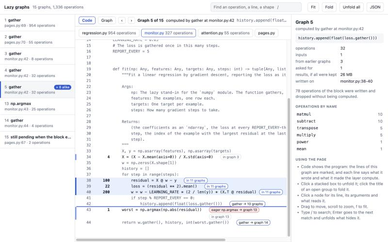
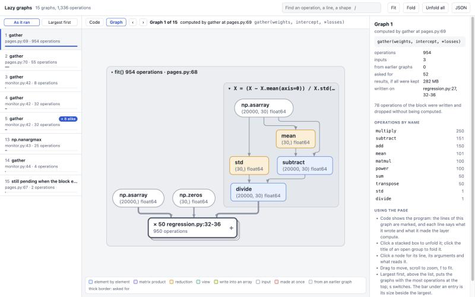
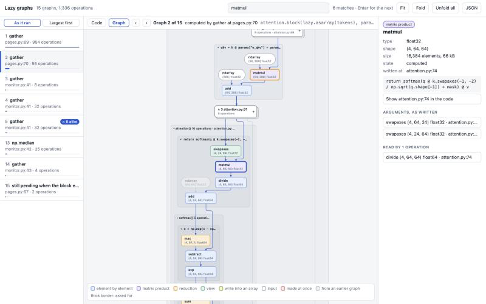
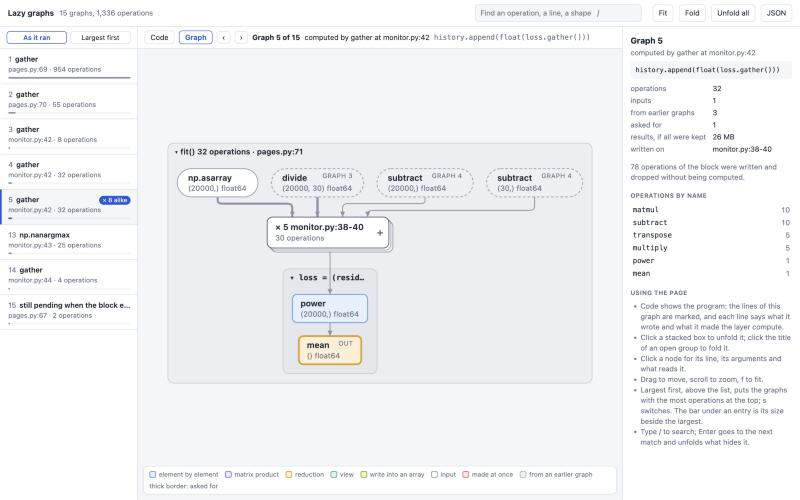

# The page that draws the lazy layer's graphs

This is a proposal for review, and a part of [lazy-design.md](lazy-design.md). [lazy-recording-design.md](lazy-recording-design.md) says how the graphs a block of code produced are recorded as plain data; this document is about drawing them, as one page in a browser.

A prototype is in [`prototypes/lazy/view.py`](../prototypes/lazy/view.py) and [`prototypes/lazy/templates/`](../prototypes/lazy/templates). Nothing here is in the package. To see it:

```bash
uv run python -m prototypes.lazy.programs.pages --out lazy-graphs.html --show
```

That runs the prototype's three example programs in one recorded block and opens the page of their 15 graphs.

## Summary

- **One HTML file.** `recording.show()` writes it and opens it in the browser; `recording.save(path)` writes it where asked. The graphs are in the file as JSON, with the script and the styles that draw them.
- **It opens on the program's code.** Every line says how many operations it wrote, which graphs they went into, and what it made the layer compute. The drawing of a graph is one click from the line, and the line one click from the drawing.
- **It is drawn in the page, not by Graphviz.** A layout library places the boxes, and the page draws SVG and answers the pointer: it folds, zooms, searches and shows what a click asks about.
- **A large graph opens folded.** A group of more than five operations is one stacked box that says what it holds, and a click unfolds it one level. The 954 operations of a 50-step loop open as four operations, three inputs and one box for the loop.
- **Nothing is hidden for good.** What a folded group reads from outside stays in sight beside it, search finds operations inside folded groups and unfolds what hides them, and the JSON holds every node.
- **The graphs of a recording are a list down the side,** each with what made the layer compute it and on which line. Graphs that are alike share one entry.
- **The prototype loads its layout library, ELK, from a CDN,** so its page needs a network connection when opened. The page of the package is to carry the library inside it. Which library ships is an [open question](#open-questions).

## The code first

A drawing of a graph says what was computed together, and not where in the program that is. So the page opens on the program, as a listing, and the graphs hang off its lines.



Graph 5 of a loop that gathers its loss every fifth step is selected in the list. In the listing:

| On a line | Meaning |
|---|---|
| A number beside the line number | How many operations the line wrote, over all its runs: `200` for a line of four operations that ran fifty times |
| A marked background | The line wrote operations of the graph that is selected. A graph is found in the code by selecting it |
| A rule under the line | The selected graph was computed because of this line |
| `in graph 3`, `in 11 graphs` | Where the line's operations went. A click opens that graph with the line's operations selected |
| `gather → 10 graphs` | The line asked for values, and these graphs were computed for it |
| `needed float() → graph 4`, `write x += y → 75 graphs` | The line made the layer compute a graph early, without `gather()` |
| `eager np.argmax → graph 13`, `eager np.dot × 150` | The line made a call the layer cannot defer: NumPy made it at once, this many times. With an arrow, operations that were pending had to be computed for it |

- **One tab per file** that wrote an operation or made the layer compute, the file with the most operations first. Selecting a graph brings up the file that holds most of it.
- **`Code` and `Graph` switch the middle** between the listing and the drawing of the selected graph. The list of graphs and the panel stay.
- **The panel says which lines a graph was written on:** `monitor.py:38-40`.
- **From a node of the drawing, `Show monitor.py:40 in the code`** goes back to the listing at that line.
- **How much code is there is the recording's choice:** whole files, only the lines that did something, with gaps between them, or line numbers alone ([lazy-recording-design.md](lazy-recording-design.md#how-much-code-a-page-carries)).

The listing is also the log in another form: the `eager`, `write` and `needed` marks are what the layer's loggers say ([lazy-design.md](lazy-design.md#what-the-layer-says)), put on the lines they are about.

## What it looks like

The regression's graph, drawn. The four operations that standardise the features are there; the loop is one box, `× 50`.



Three areas:

| Area | What is in it |
|---|---|
| Left | The graphs of the recording, in order: what triggered each, the line, the number of operations. `× 8 alike` marks graphs that are the same in every operation, shape, type and line. `no gather` marks a graph that was computed because something needed a value and `gather()` was not called |
| Middle | The program's code, or the drawing of the selected graph. Above it, the two tabs, what made the layer compute the graph, the line, and the text of that line |
| Right | The selected node; or, with nothing selected, the graph: counts, the lines it was written on, and its operations by name |

The transformer block after typing `matmul` in the search box and pressing Enter twice. Six operations match and have an orange border. The second match is selected: the panel has its type, shape, size, line, arguments and readers, and the drawing lights up what leads to it and what follows from it.



One of the graphs of a loop that gathers its loss every fifth step. The three dashed nodes were computed by earlier graphs, and each says which; the thick border and `out` mark what the `gather` asked for.



What is drawn:

- **An operation** is a box with its name and, under it, the shape and element type of its result. Its colour is its kind: element by element, matrix product, reduction, view, or a write into an array; indexing by arrays is drawn as a view is. That makes a chain of element-by-element operations ending in a reduction visible at a glance, which is the first thing fusing would look for.
- **An input** is a pill: `np.zeros`, `np.asarray`, `ndarray`. A result of a call made at once has a colour of its own, since it marks a cut.
- **An open group** is a frame with a title: a line of code, `softmax()`, `× 50`.
- **A folded group** is a stack of cards with its title and how many operations it holds.
- **An edge** runs from a node to what reads it. Between folded groups one edge stands for all the arrays that pass, and is thicker the more there are.

## What a reader can do

| Do | And |
|---|---|
| Click `Code` or `Graph` | The middle shows the program's lines, or the drawing of the selected graph |
| Click a graph in the list while the code is shown | Its lines are marked, and the file that holds most of them comes up |
| Click a mark on a line: `in graph 3`, `gather → 10 graphs`, `eager np.argmax → graph 13` | The drawing of that graph, with the first operation of that line selected and whatever hid it unfolded |
| Select a node and click `Show monitor.py:40 in the code` | The listing, at that line |
| Click a folded group | It unfolds one level, and stays where it was on the screen |
| Click the title of an open group | It folds |
| Click a node | It is selected. The panel shows its type, shape, size, state, line and the text of the line, its arguments as written and what reads it. On the drawing, everything it depends on and everything that depends on it stays lit and the rest is dimmed |
| Click an argument or a reader in the panel | The drawing goes to that node, unfolding what hides it |
| Select a dashed node and click `Computed by graph 4: go there` in the panel | The page goes to that graph and selects the node there |
| Hover a node, a group or an edge | A tip: the line of code; for a group, its operations by name and how many of the arrays asked for it holds; for an edge, what passes along it and its size |
| Type in the search box, or press `/` | Operations whose name, line, code, shape or type match get a border. A folded group shows how many matches are inside it |
| Press Enter in the search box | The drawing goes to the next match, unfolding what hides it. Matches by name come first |
| Click a name under "Operations by name" | The search is set to that name |
| Drag, scroll, pinch | Move and zoom |
| `Fit`, or `f` | The whole graph in the window |
| `Fold` | Back to how the graph opened |
| `Unfold all` | Every group open, except the middle of long loops |
| `JSON` | The graphs as a file |
| Click a graph in the list, or `‹` `›` | Another graph. Clicking an entry of several graphs alike goes through them |

## Folding

The tree of groups comes with the graph ([lazy-recording-design.md](lazy-recording-design.md#groups)). The page decides only what is open.

- **A group of more than five operations opens folded.** Five is one constant, passed to the page with the data.
- **A long function opens as stretches of lines.** A function of a hundred lines has no line large enough to fold, and would open as hundreds of boxes. The record cuts such a call into groups of eight lines that follow each other ([lazy-recording-design.md](lazy-recording-design.md#groups)), and each opens folded: `lines 71 to 78`.
- **The middle of a long loop is always folded at first:** `steps 3 to 49`.
- **While the top holds one folded group and nothing else, that group is opened.** A recorded block is usually one call of one function; a page that opens on one box says nothing.
- **A graph opens at a size that can be read.** If the whole graph fits with readable text it is shown whole; otherwise it is shown from the top at its width, and the rest is a drag away. `Fit` shows the whole.
- **Folding is the page's state, not the data's.** It is kept per graph while the page is open.

For the regression this gives ten things at first: two frames, three inputs, the four operations of one line, and the loop. Unfolding `× 50` gives `step 1 of 50`, `step 2 of 50`, `steps 3 to 49` and `step 50 of 50`; unfolding a step gives its five lines; unfolding a line gives its operations.

## Inputs and outputs

- **An input is drawn in the innermost group that holds everything that reads it.** A weight matrix sits beside the one product that uses it, inside that line's frame, and not in a row above the whole graph. The features of the regression, read by every step, sit beside the loop.
- **The inputs of a folded group stay in sight.** They are drawn beside it, with an edge into it. When there are more than four they are one pill, `14 inputs`, whose tip lists them; a click on it unfolds the group.
- **A node computed by an earlier graph is dashed** and labelled with that graph's number.
- **What the trigger asked for has a thick border and the label `out`.** A folded group that holds any of it has the thick border too, and its tip says how many.

## How it is drawn

- **The page is a Jinja template** with three things put into it: the data as JSON, a stylesheet and a script. The data is the graphs, the counts of what was computed without being asked by line, and the text of the program's lines as the recording was told to carry it. `jinja2` is a dependency of the package already, so the page adds no Python dependency.
- **The JSON sits in a script element of its own** and is read once. Every `</` in it is written `<\/`, so a line of the user's code that contains `</script>` cannot end the element. Text from the data reaches the page as text, never as markup.
- **The script keeps a set of folded groups per graph.** From it, it works out what is visible: one element per visible node, folded group and open group, and one edge per pair of elements that data passes between.
- **A layout library is asked where everything goes.** The prototype uses ELK's layered layout, with groups as nested boxes and edges routed at right angles. Operations are given to it in the order the program wrote them, and it is asked to respect that order, so the drawing reads top to bottom as the code does.
- **The page draws the SVG itself:** boxes, text, edges with rounded corners. Pan and zoom are a transform on one group. Folding and unfolding run the layout again on what is visible, which is small, since most of a large graph is folded.
- **Light and dark** follow the reader's system setting.

- **The listing is built from the same data:** each operation names its line, each graph the line that triggered it, each count of an eager call its line. No second pass over the program is made.

About 1,200 lines of JavaScript, 290 of CSS and 100 of Python.

## The layout library

| | In the prototype | In the package |
|---|---|---|
| The library | ELK, as `elkjs` 0.9.3 | An open question |
| How the page gets it | A script element pointing at a CDN. The page needs a network connection when it is opened | Shipped inside the package and written into the page, so the page stands alone and can be sent to someone |

Why a library for the layout and nothing else:

- **Layered layout of nested groups is the hard part.** Placing boxes in layers so that edges run one way, with groups inside groups and edges that cross their borders, is a field of its own. ELK does it and takes the nesting as given.
- **Drawing and interaction are not hard,** and doing them in the page keeps every decision about how a node looks and what a click does in a few hundred lines that can be read.
- **A drawing library on top was not needed.** Cytoscape.js was the first candidate. It brings its own renderer and its own model of what is on screen; with folding done by the page, what was left for it to do was draw rectangles.

What has to be settled before a library goes into the package: its licence and what the licence asks of a package that redistributes it, what it adds to the size of the wheel, and whether a smaller layout (dagre) is good enough for nested groups.

## What was verified

In one browser, the pane built into the Claude desktop app, on the page of the three example programs (15 graphs, 1,336 operations, a file of 551 kB):

- The page loads the library and draws each graph, with no error in the console.
- Unfolding and folding by click, with the clicked group staying in place.
- Selecting a node: the panel, the lit path and the dimmed rest.
- Search, Enter going to the next match and unfolding the groups that hide it, and the count of matches inside a folded group.
- The tip of a node, of a folded group and of an edge.
- A graph reading results of earlier graphs, and the jump from a dashed node to the graph that computed it.
- The transformer block folded to one box, with its 14 inputs as one pill beside it.
- An entry of eight graphs alike going from one to the next, and a name under "Operations by name" setting the search.
- `Unfold all` on the regression: 86 elements drawn, and `Fit` showing all of them.
- The dark colours, on one graph.
- The `no gather` mark, on a page of seven graphs computed by `float()` in a loop and by `np.asarray`.
- A graph of 366 operations from one function of a hundred lines, opening as three stretches of lines, and one of them unfolding into eight.
- The code view on the three example programs: the lines of a selected graph marked and its file brought up; a mark on a line opening the drawing with that line's operation selected; `Show … in the code` going back to the line; one mark, not two, for an eager call that also computed a graph.
- The code view on Karpathy's `min-char-rnn.py`, 112 lines and 749 graphs, with 17 marks of eager calls.
- Four of the pages of the ten programs of [lazy-design.md](lazy-design.md#ten-programs-with-one-changed-line), of 1, 4, 83 and 749 graphs, loading without an error in the console. The other six were written and not opened.

One test in [`tests/test_lazy_graphs.py`](../tests/test_lazy_graphs.py) holds the file itself: that it contains the graphs as JSON that reads back, the library's URL, and exactly three script elements when a line of the recorded code contains `</script>`.

Two things were found by looking and changed:

- **Inputs in a row above the graph made it unreadable.** The transformer block has 14, and they made the drawing wider than it was tall. They are now drawn where they are read.
- **A minimum width asked of an open group was applied to its height** by the layout running downwards. No minimum is asked; a title that does not fit its frame is cut.

## Considered and not proposed

| Option | Why not |
|---|---|
| Graphviz | A static picture, and a program to install. A page folds, zooms and answers a click, and needs only a browser |
| A drawing library with its own model (Cytoscape.js, a flow-diagram component) | See [The layout library](#the-layout-library). The second kind also wants a build step and a framework |
| Lay everything out once and hide what is folded | A graph of 100,000 operations would have to be laid out whole before the first box is shown. Laying out only what is visible keeps the work to what is on the screen |
| Draw every step of a loop | It is the picture nobody can read. The steps are alike, which is what `× 50` says |
| Show shapes on the edges | Each node already shows the shape of its result, and the edge's tip repeats it. Labels on every edge crowd the drawing |

## Open questions

- **The library that ships.** ELK is what the prototype uses. To be checked: its licence, its size in the wheel, and dagre as a smaller alternative.
- **What the listing does with a line that ran in many graphs.** It says `in 11 graphs` and opens one of them. Stepping through them from the line is not there.
- **Whether a file of thousands of lines should be shown whole.** It is.
- **The fold constant, and the four inputs above which a folded group's inputs are one pill.** Chosen by looking at three programs.
- **A second direction.** The layout runs downwards, as code reads. A wide screen has more room across; left to right is one option of the library and was not tried.
- **Whether a notebook should get the page in a frame under the cell.** The prototype's objects have the method a notebook looks for; it was not tried in one.

## Not examined

- **Other browsers.** One was used.
- **The code view with only the lines that did something, and with no code.** Both are held by a test of the page's data; neither was looked at in a browser.
- **A notebook.**
- **A very large graph.** The largest drawn was 2,059 operations, three iterations of a recurrent network's training, which opened folded as 15 elements; unfolded, the most on screen was 86, for another graph. How long the layout takes on thousands of visible elements was not measured.
- **The page without a network connection.** It says the library could not be loaded; that message was not looked at in a browser.
- **A keyboard alone, and a screen reader.** The drawing is reached by pointer.
- **A touch screen.**
